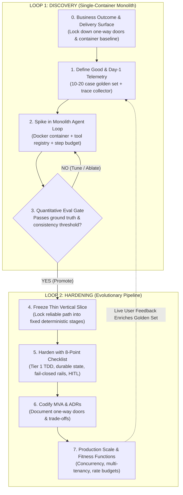
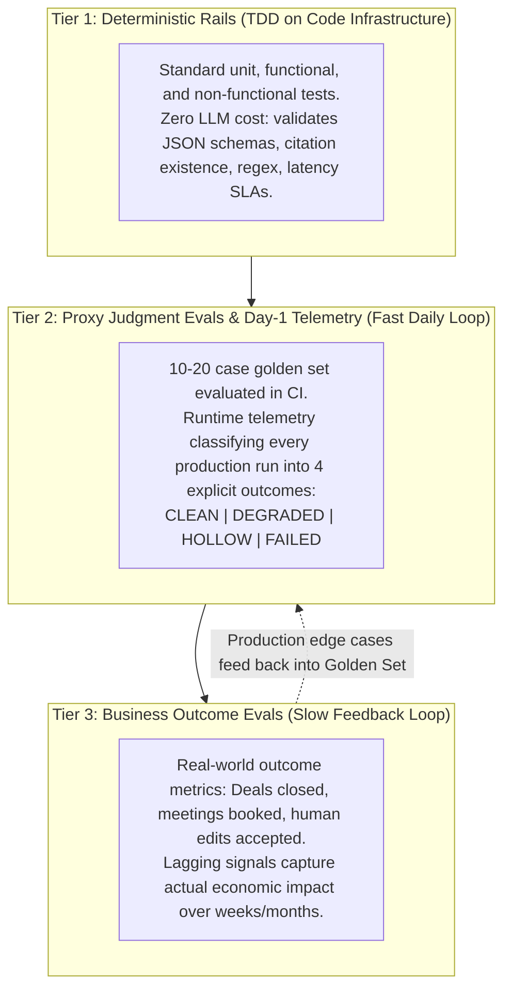

# AI-Native Engineering Framework
**By Ram Senthil-Maree ([@maree217](https://github.com/maree217))**

An architectural, eval-driven framework for engineering reliable, production-grade AI systems inside organizations.

[](https://github.com/maree217/ai-native-engineering/actions/workflows/ci.yml)
[](LICENSE)
[](https://www.python.org/)

---

## The idea in one paragraph

Coding agents now write most of the code. What they can't own are the eight decisions that are expensive to undo. This framework is the path to owning them, and four of the eight belong to the people who know the work, not the engineers.

---

## Start here

Pick the door that fits you. Each one is a complete route through the repo.

| If you are... | Start with | Then read |
| :--- | :--- | :--- |
| **Leading a team** | [The eight one-way doors](#the-eight-one-way-doors) and [Your first job: write the answer key](#your-first-job-write-the-answer-key) | [Four outcomes, not a demo](#four-outcomes-not-a-demo), [One harness, four systems](#one-harness-four-systems), [Chapter 1: The Shift](docs/01-the-shift.md) |
| **Learning to build** | [The learning path](#the-learning-path) | [The guide](GUIDE.md), the three [examples](examples/), the [ship checklist](templates/ship-checklist.md) and the [suggested capstone](#suggested-capstone) |
| **Engineering** | [For engineers](#for-engineers): the two loops and the eval stack | [Chapter 2: The Loop](docs/02-the-loop.md), [Chapter 3: Evals and Telemetry](docs/03-evals-and-telemetry.md), [Chapter 4: Case Study and Defence](docs/04-case-study-and-defense.md), [Chapter 5: Prior Art](docs/05-prior-art-lineage.md) |

---

## The eight one-way doors

A one-way door is a decision that is slow, costly or risky to reverse. A coding agent can write the code behind each one. It can't decide it for you.

| # | The question (plain English) | Engineering term | Who owns it |
| :---: | :--- | :--- | :--- |
| 1 | What does good look like, in real examples? | Eval-driven definition of done | **Business owns** |
| 2 | Where do people actually work? | Delivery surface | **Business owns** |
| 3 | Where does a human sign before anything leaves? | Human-in-the-loop gate | **Business owns** |
| 4 | What data is allowed in, and what must never go in? | Data boundary | **Business owns** |
| 5 | Fixed pipeline or free agent, and why? | Orchestration vs autonomy | Builder proves |
| 6 | Where is AI output trusted, and where is it checked? | Trust boundary / fail-closed | Builder proves |
| 7 | When it fails, what survives and how does it resume? | Durable state and recovery | Builder proves |
| 8 | What do other systems rely on it to return? | Integration contract | Builder proves |

**Business owns** means the person who knows the work answers it. **Builder proves** means the builder answers it with evidence: a test, a trace, an eval result or an [ADR](templates/adr-template.md).

More on the doors and why they matter: [Chapter 1, section 4](docs/01-the-shift.md#4-one-way-doors-vs-agent-delegated-decisions).

---

## Your first job: write the answer key

Before anyone builds anything, the people who know the work write down fifteen real examples of the right answer. Include three to five edge cases: the awkward, ambiguous or hostile ones that trip people up.

That answer key does two jobs at once. It is the spec, because it says what good looks like. It is also the acceptance test, because the system has to match it before it ships.

The format is a plain JSON list of cases, each with an input and the expected answer. See [examples/01-eval-harness/golden_cases.json](examples/01-eval-harness/golden_cases.json) for a working example. Engineers call this a golden set. The detail is in [Chapter 3](docs/03-evals-and-telemetry.md).

---

## The learning path

Five stages, one per week to start with. Each week ends with a clear test of whether you're finished.

### Week 0: outcome and surface

No code. Write one paragraph that names the outcome you want, the person it serves and where they already work (Teams, Slack, email, a browser, a phone).

**You're done when one paragraph names the outcome, the person it serves and where they already work.**

Read: [GUIDE.md, section 1](GUIDE.md#1-what-you-design-up-front-and-what-you-defer).

### Week 1: the answer key

Sit with someone who knows the work. Write fifteen cases by hand, including three to five edge cases. Use [golden_cases.json](examples/01-eval-harness/golden_cases.json) as the format.

**You're done when 15 hand-written cases exist and someone who knows the work has signed them off.**

### Week 2: the spike

Let a coding agent build an open loop: a model that can call tools, with a hard limit on how many steps it may take. Record a trace of every run. Put it in front of a real user. This is a discovery tool. It never ships.

**You're done when a real user has tried it and every run has a trace.**

Example: [examples/02-monolith-spike](examples/02-monolith-spike/README.md).

### Week 3: the gate

Run your answer key through the harness and count how many runs land in each of the [four outcomes](#four-outcomes-not-a-demo). Compare the counts with the bar you set in Week 1.

**You're done when it clears the bar you set in Week 1, or you've written down why not.**

Example: [examples/01-eval-harness](examples/01-eval-harness/README.md).

### Week 4 onwards: harden

Freeze the path that worked into fixed stages. Then work through the ship checklist and write an ADR (a half-page decision record) for each one-way door you hit.

**You're done when every checklist item has evidence.**

Example: [examples/03-hardened-slice](examples/03-hardened-slice/README.md). Templates: [ship-checklist.md](templates/ship-checklist.md) and [adr-template.md](templates/adr-template.md).

---

## Four outcomes, not a demo

A demo shows that something ran. Every real run lands in one of four outcomes, and you count them.

| Outcome | What it means |
| :--- | :--- |
| **Clean** | Did the job, checked. |
| **Degraded** | Finished, but something fell back or was skipped, and it says so. |
| **Hollow** | Finished without an error, but the output is empty, stale or made up. |
| **Failed** | Stopped safely, nothing sent. |

Hollow is the dangerous one. Nothing looks wrong until someone reads the output. The four outcomes are explained in full in [Chapter 3](docs/03-evals-and-telemetry.md#day-1-telemetry-the-4-state-production-taxonomy).

---

## One harness, four systems

The same pattern runs across four systems. Answer key, gate, four outcomes, and nothing ships until the evidence says so.

**Sentinel (live).** "Monitoring said healthy, and it wasn't." A nightly reconcile now compares the dashboard to the database (last drift: zero). A nightly canary passes only if enough claims trace to a real source and no engine silently fell back. A 60-second watchdog raised an alert at 07:50 on 22 Oct 2026, and the service was back at 07:51.

**Sentinel retrieval (still in the lab).** recall@5 went from 0.49 to 0.97 on a spike costing about $12. It is not on the live path because it hasn't cleared the gate yet.

**Ombudsman loop (nightly).** 16,916 public Housing Ombudsman decisions. A change is kept only if it beats the current version with statistical confidence on held-out data. On 60 changes that did nothing, a naive "score went up" rule accepted 32; the gate accepted 13. Sealed score 0.41 to 0.49 macro-F1.

**Outreach outbox (hardened).** "The design was careful. The code didn't enforce it." An audit found records written after sending, a limit that only warned, and suppression failing open. Fixed: record before send, fail closed, and backup plus a restore test first.

To be clear about this repo: the examples here are teaching-sized versions of these patterns, and they run on mocks today. A real model call is on the roadmap.

---

## For engineers

The framework pairs a two-loop lifecycle with a three-tier eval stack.

Anthropic recommends starting with a fixed workflow and adding autonomy only when needed. This framework agrees about production, but deliberately starts somewhere else. Loop 1 begins with an open agent loop as a discovery instrument that never ships. Once the evidence shows what works, that path is frozen into a fixed pipeline, and only the frozen pipeline goes to production. More in [Chapter 5](docs/05-prior-art-lineage.md#2-anthropic-building-effective-agents-erik-schluntz--barry-zhang).

### The two loops



- **Loop 1 (discovery spike):** an open agent loop with tools, in a single container, with a hard step budget. It exists to learn what works with real users. It never ships.
- **Eval gate:** the line between discovery and production. Schema checks, citation checks and the bar set by the answer key.
- **Loop 2 (hardened slice):** the path that worked, frozen into fixed stages (for example `ingest -> normalize -> retrieve -> judge -> verify -> emit`). Each stage can be tested on its own and recovers predictably.

Full detail: [Chapter 2: The Loop](docs/02-the-loop.md).

### The three-tier eval stack



1. **Tier 1, deterministic rails:** plain unit and contract tests. They check schemas, citations and types before any model is called, and cost nothing to run.
2. **Tier 2, answer key and day-1 telemetry:** the answer key runs in CI, and every live run is sorted into Clean, Degraded, Hollow or Failed.
3. **Tier 3, business outcomes:** slower signals such as meetings booked or edits accepted. Where people and the system disagree, the case goes back into the answer key.

Full detail: [Chapter 3: Evals and Telemetry](docs/03-evals-and-telemetry.md).

### The docs

| Chapter | What it covers |
| :--- | :--- |
| [01. The Shift](docs/01-the-shift.md) | Why the classic delivery lifecycle breaks with probabilistic systems; the one-way doors. |
| [02. The Loop](docs/02-the-loop.md) | Loop 1 and Loop 2, the eval gate, the ship checklist, minimum viable architecture. |
| [03. Evals and Telemetry](docs/03-evals-and-telemetry.md) | The three tiers, golden set design, the four outcomes, fail-closed policies. |
| [04. Case Study and Defence](docs/04-case-study-and-defense.md) | Sentinel in detail, the hollow run, a three-minute walkthrough, common objections. |
| [05. Prior Art and Lineage](docs/05-prior-art-lineage.md) | How this relates to Poteto, Anthropic, Husain and Shankar, Chip Huyen, ThoughtWorks, AWS and TOGAF. |

### Run the examples

Pure Python standard library, no dependencies. From the repo root:

```bash
PYTHONDONTWRITEBYTECODE=1 python3 -m unittest discover -s examples -p "test_*.py" -v
```

---

## Suggested capstone

Build a small keep-if-better loop on public Housing Ombudsman decisions.

1. Write 15 golden cases, including three to five edge cases.
2. Build a baseline and record its score.
3. Write a gate that rejects any change that doesn't beat the baseline on held-out data.

Then submit your answer key and your outcome counts through the [case-study issue template](.github/ISSUE_TEMPLATE/case-study-submission.md). For a shorter version of the same exercise, see [GUIDE.md, section 9](GUIDE.md#9-capstone-exercise-build-and-defend-your-own-slice).

---

## Repo map

| Path | What's there |
| :--- | :--- |
| [GUIDE.md](GUIDE.md) | The whole framework in one read. |
| [docs/](docs/) | Five chapters, from the shift to prior art. |
| [examples/](examples/) | Three runnable examples: [eval harness](examples/01-eval-harness/README.md), [monolith spike](examples/02-monolith-spike/README.md), [hardened slice](examples/03-hardened-slice/README.md). |
| [templates/](templates/) | [ADR template](templates/adr-template.md) and [ship checklist](templates/ship-checklist.md). |
| [assets/](assets/) | Four reference posters. |
| [.github/ISSUE_TEMPLATE/](.github/ISSUE_TEMPLATE/) | [Framework feedback](.github/ISSUE_TEMPLATE/framework-feedback.md) and [case-study submission](.github/ISSUE_TEMPLATE/case-study-submission.md). |

---

## License

MIT © 2026 Ram Senthil-Maree
