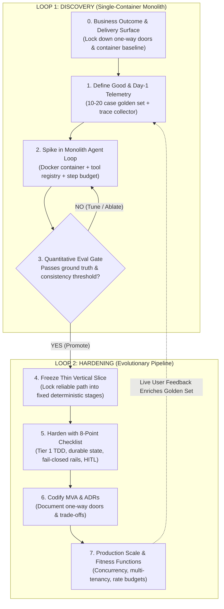
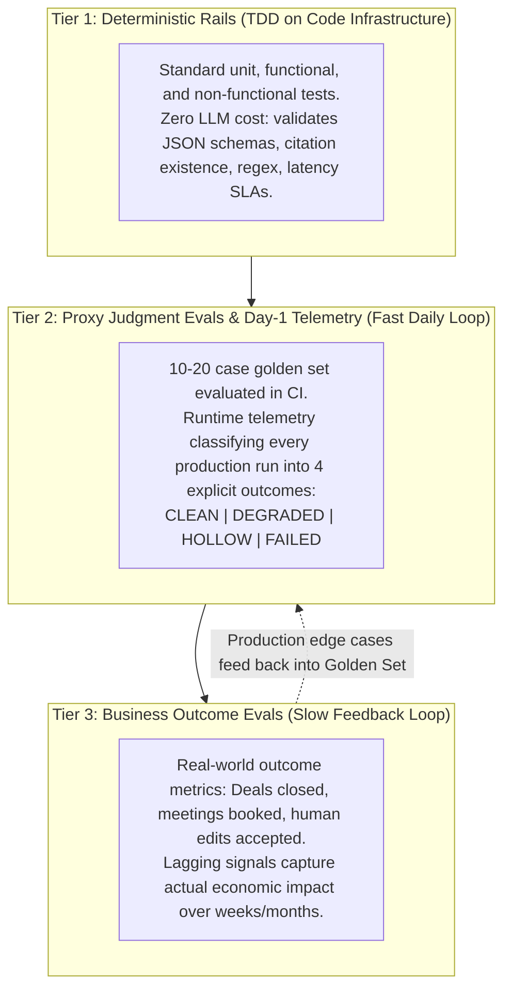
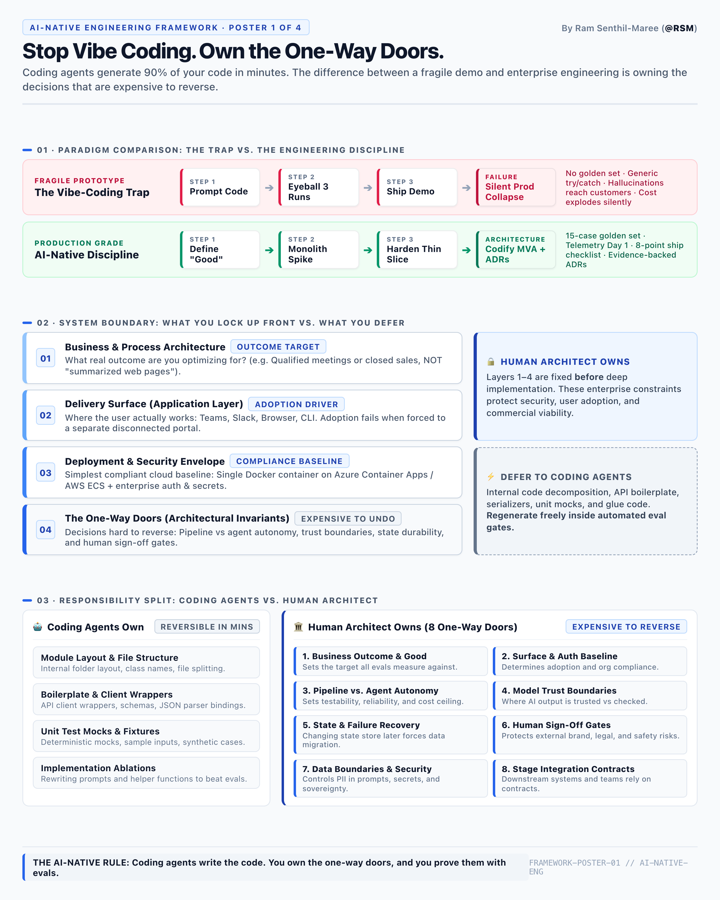

# AI-Native Engineering Framework
**By Ram Senthil-Maree ([@RSM](https://github.com/RSM))**

An architectural, eval-driven framework for engineering reliable, production-grade AI systems inside organizations.

[](.github/workflows/ci.yml)
[](LICENSE)
[](https://www.python.org/)

---

## The Thesis

Coding agents can generate 90% of your application code in minutes. That velocity makes it trivially easy to ship a prototype that looks finished, passes zero real checks, and collapses the moment it touches real users, hostile edge cases, or enterprise security reviews.

The difference between **vibe coding** and **AI-native engineering** is not how well you prompt. It is whether you:
1. **Own the one-way doors** — the architectural decisions that are expensive, slow, or dangerous to reverse.
2. **Enforce deterministic rails before model calls** — syntax, schemas, and citations validated in pure code before consuming tokens.
3. **Wire day-1 runtime telemetry** — continuously classifying every run into `CLEAN`, `DEGRADED`, `HOLLOW`, and `FAILED` states.
4. **Prove reliability before declaring architecture** — evolving from an unconstrained discovery spike into a hardened, fixed-stage pipeline only when quantitative eval gates pass.

```
       ▲  [HUMAN ARCHITECTURAL JUDGMENT]   ◄── One-way doors, failure boundaries, blast radius
      / \
     /   \ [SCALED DELEGATION]             ◄── Coding agents generate 90% of code & boilerplate
    /     \
   /       \ [AUTOMATED EVIDENCE]          ◄── Tier 1 Deterministic TDD & Tier 2 Golden Evals
  /─────────\
 /           \ [STATIC & RUNTIME RAILS]     ◄── Container boundaries, schemas, typed contracts
 ═════════════
```

---

## Core Architecture

The framework couples a **Two-Loop Development Lifecycle** with a **Three-Tier Testing & Eval Stack**:

### 1. The Two-Loop Lifecycle



- **Loop 1 (Discovery Spike):** Rapid exploration within a single-container monolith. An open agent loop with dynamic tools tests hypotheses against real users in a safe sandbox. Bounded by a strict step budget to prevent runaway token costs.
- **Eval Gate:** The quantitative barrier separating discovery from production. Enforces deterministic schema validation, source citation verification, and minimum accuracy thresholds on golden cases.
- **Loop 2 (Hardened Slice):** Freezes the discovered reliable path into a fixed, predictable multi-stage pipeline (e.g., `ingest -> normalize -> retrieve -> judge -> verify -> emit`). Maximizes unit testability, auditability, and deterministic error recovery.

### 2. The Three-Tier Eval Stack



1. **Tier 1 (Deterministic TDD):** Pure code unit and contract tests running in milliseconds. Validates schemas, citation presence, and payload types before any LLM is called.
2. **Tier 2 (Proxy Judgment & Day-1 Telemetry):** Daily evaluation using a curated 10–20 case golden set per domain, combined with runtime telemetry classifying every execution:
   - **`CLEAN`**: Flawless technical and semantic execution; grounded citations verified.
   - **`DEGRADED`**: Safe fallback execution with partial evidence or low confidence.
   - **`HOLLOW`**: Silent failure detected (process returned exit code 0 / HTTP 200, but payload is empty, placeholder, or ungrounded). *Liveness is not correctness.*
   - **`FAILED`**: Loud, handled exception safely stopped before external mutations.
3. **Tier 3 (Business Outcomes):** Lagging economic metrics (e.g., qualified meetings booked, revenue pipeline). Discrepancies between human decisions and model output feed directly back into the Tier 2 golden set.

---

## Framework Documentation

The complete framework is documented across 5 in-depth chapters:

| Chapter | Focus & Key Topics |
| :--- | :--- |
| **[01. The Shift](docs/01-the-shift.md)** | Probabilistic Execution vs Deterministic SDLC; Why Classic SDLC Fails; Architecture-First Mindset (TOGAF/BDAT $\to$ Business Eval $\to$ App Layer $\to$ Infra Baseline); One-Way Doors Matrix. |
| **[02. The Two-Loop Lifecycle](docs/02-the-loop.md)** | Loop 1 Discovery Spike (Docker Monolith + Tool Registry) vs Loop 2 Hardening; Quantitative Eval Gate; Freezing Agent Loops into Fixed Pipelines; 8-Point Ship Checklist; Minimum Viable Architecture (MVA). |
| **[03. Evals & Telemetry](docs/03-evals-and-telemetry.md)** | The Three-Tier Eval Stack; Code-First Rail Invariants; 10–20 Golden Set Design; Cross-Provider Judge Rule; 4-State Telemetry Taxonomy (`CLEAN`, `DEGRADED`, `HOLLOW`, `FAILED`); Fail-Closed Policies. |
| **[04. Case Study & Defense](docs/04-case-study-and-defense.md)** | Sentinel Production System; Exact Metrics (`0.49 -> 0.97 recall@5` lab-only; 46 runs: `30 clean, 15 degraded, 1 hollow`); Anatomy of the 1 `HOLLOW` Run; 3-Minute Walkthrough Pitch; 6 CTO Objection Defenses. |
| **[05. Prior Art & Lineage](docs/05-prior-art-lineage.md)** | Deep comparative analysis against The Poteto Pyramid, Anthropic, Husain & Shankar, Chip Huyen, ThoughtWorks Evolutionary Architecture, AWS GenAI Lens, and TOGAF/BDAT. |

---

## Operational Templates

Production-ready engineering templates located in `templates/`:

| Template | Purpose |
| :--- | :--- |
| **[Architecture Decision Record (ADR)](templates/adr-template.md)** | Standardized half-page decision template designed specifically for AI one-way doors (reversibility rating, eval evidence, fail-closed kill switches, and next fitness functions). |
| **[Production Ship Checklist](templates/ship-checklist.md)** | 8-point production hardening checklist. Every vertical slice must satisfy all 8 criteria before shipping to production. If an item is incomplete, mark it **"Next"**, not **"Done"**. |

---

## Prior Art & Lineage Summary

AI-Native Engineering synthesizes and extends seven foundational systems engineering frameworks:

| Source / Prior Art | Foundational Concept | Overlap in this Framework | Where This Framework Extends It |
| :--- | :--- | :--- | :--- |
| **The Poteto Pyramid**<br>*(Lauren Tan / `@poteto`)* | Inverted hierarchy of agent delegation. | Human architect owns one-way doors; agents generate code. | Operationalizes Automated Evidence via 3-Tier Evals and 4-state telemetry. |
| **Building Effective Agents**<br>*(Anthropic)* | Workflows (deterministic) vs Agents (autonomous). | Loop 1 uses agent loops; Loop 2 freezes reliable workflows. | Adds quantitative Eval Gate, fail-closed citation gates, and 8-point ship checklist. |
| **Applied LLM Evals**<br>*(Husain & Shankar)* | 10–20 golden cases and code-first assertions. | Tier 1 deterministic code rails run before Tier 2 golden evals. | Links golden sets directly to live production telemetry; automates feedback loop. |
| **AI Engineering**<br>*(Chip Huyen)* | Eval-driven design and telemetry as data pipeline. | Full instrumentation of runs; traces serve as eval inputs. | Formalizes `HOLLOW` silent failure state and enforces strict step budgets. |
| **Evolutionary Architecture**<br>*(ThoughtWorks)* | Architectural fitness functions guarding system properties. | Continuous CI/CD gating against regression, drift, and latency. | Defines AI-specific fitness functions (groundedness, token budgets, cross-provider bias). |
| **AWS GenAI Lens / P2P**<br>*(AWS)* | Cloud security, governance, and prototype-to-production path. | Secure single-container deployment envelope; VPC egress. | Replaces multi-week design specs with lightweight, empirical ADRs. |
| **TOGAF / BDAT**<br>*(The Open Group)* | Business $\to$ Data $\to$ App $\to$ Tech alignment. | Business outcome and delivery surface locked down before model selection. | Strips waterfall bureaucracy; converts BDAT into iterative, eval-driven execution. |

*For the complete detailed comparative analysis, see [Chapter 5: Prior Art & Lineage](docs/05-prior-art-lineage.md).*

---

## Production Case Study: Sentinel

The patterns in this framework were validated on **Sentinel**, an automated B2B sales intelligence and outreach pipeline:

- **Lab vs. Live Retrieval Tuning**: `0.49 -> 0.97 recall@5` for `~$12` in API credits (**lab-only**, not yet promoted to live path).
- **Day-1 Telemetry in Production**: Across **46 runs** in 30 days: `30 clean, 15 degraded, 1 hollow, 0 failed`.
- **Golden Set Size**: `~10 golden cases / sector` (including hostile edge cases).
- **Judge Calibration**: LLM judge currently **uncalibrated vs human labels** (acknowledged system boundary).

*For the full architectural breakdown, failure analysis, and CTO objection defenses, see [Chapter 4: Case Study & Architectural Defense](docs/04-case-study-and-defense.md).*

---

## Runnable Examples & Quickstart

The repository includes three pure Python 3 standard library reference implementations with zero external dependencies:

| Example | Pattern Demonstrated | Documentation |
| :--- | :--- | :--- |
| **`examples/01-eval-harness`** | Tier 1 deterministic schema & citation rails + Tier 2 run classification (`CLEAN`, `DEGRADED`, `HOLLOW`, `FAILED`). | [README](examples/01-eval-harness/README.md) |
| **`examples/02-monolith-spike`** | Loop 1 single-container monolith spike with tool registry, hard step budget, and structured trace emission. | [README](examples/02-monolith-spike/README.md) |
| **`examples/03-hardened-slice`** | Loop 2 fixed 6-stage pipeline (`ingest -> normalize -> retrieve -> judge -> verify -> emit`) with fail-closed citation verification. | [README](examples/03-hardened-slice/README.md) |

### 1. Run the Complete Test Suite

Execute all 22 unit tests across all three examples:

```bash
PYTHONDONTWRITEBYTECODE=1 python3 -m unittest discover -s examples -p "test_*.py" -v
```

### 2. Run Individual Example Suites

```bash
# Example 01: Eval Harness & 4-State Classification
cd examples/01-eval-harness && python3 -m unittest test_eval_harness.py -v

# Example 02: Loop 1 Monolith Spike & Step Budget
cd examples/02-monolith-spike && python3 -m unittest test_monolith_spike.py -v

# Example 03: Loop 2 Hardened 6-Stage Pipeline
cd examples/03-hardened-slice && python3 -m unittest test_hardened_slice.py -v
```

---

## Visual Architecture Posters

<details>
<summary><strong>Visual Posters (4 high-res reference sheets)</strong></summary>

These visual posters provide supplementary visual references summarizing the framework principles:

| 1. The Paradigm Shift | 2. The 2-Loop Lifecycle |
| :---: | :---: |
| [](assets/poster-1-the-shift.png) | [](assets/poster-2-the-loop.png) |
| *What you design upfront vs. what you defer to code agents* | *Loop 1 discovery spike evolving into Loop 2 hardened slice* |

| 3. Evals & Hardening | 4. Case Study & Defense |
| :---: | :---: |
| [](assets/poster-3-evals-and-hardening.png) | [](assets/poster-4-case-study-and-defense.png) |
| *3-tier eval pyramid & 8-point production checklist* | *Sentinel production numbers & 3-minute architecture pitch* |

</details>

---

## Feedback & Case Studies

Practicing engineers, architects, and technical leaders are invited to submit feedback and production case studies:
- Submit framework improvements or critiques via [Framework Feedback](.github/ISSUE_TEMPLATE/framework-feedback.md).
- Share an anonymized production study via [Case Study Submission](.github/ISSUE_TEMPLATE/case-study-submission.md).

---

## License

MIT © 2026 Ram Senthil-Maree
