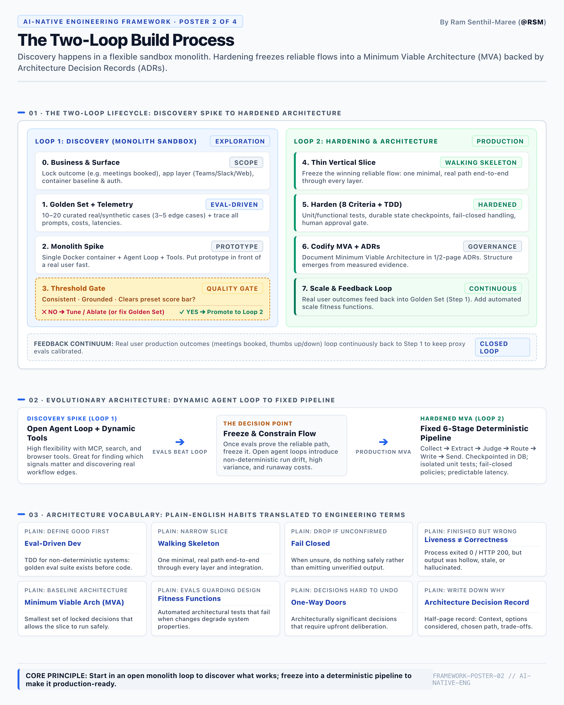
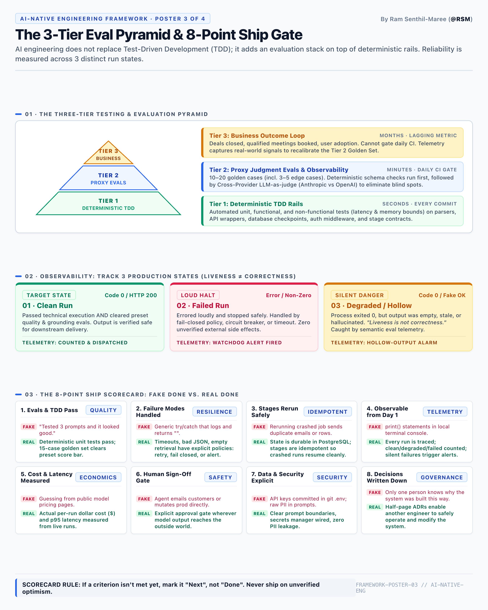
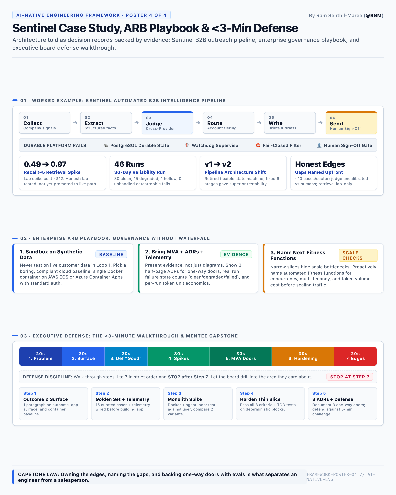

# AI-Native Engineering Framework
**By Ram Senthil-Maree ([@RSM](https://github.com/RSM))**

An architectural, eval-driven framework for engineering reliable, production-grade AI applications inside organizations.

---

## Overview

Coding agents can generate 90% of application code in minutes. That velocity makes it trivially easy to produce prototypes that pass zero real checks and fail the moment they face real users, compliance gates, or enterprise security reviews.

The difference between **vibe coding** and **AI-native engineering** is owning the one-way doors (decisions that are expensive to reverse), instrumenting observability and evals from day one, and proving reliability before declaring anything architecture.

```
       ▲  [HUMAN ARCHITECTURAL JUDGMENT]   ◄── One-way doors & governance
      / \
     /   \ [SCALED DELEGATION]             ◄── Coding agents generate 90% code
    /     \
   /       \ [AUTOMATED EVIDENCE]          ◄── Tier 1 TDD & Tier 2 Evals
  /─────────\
 /           \ [STATIC & DOCKER SAFEGUARDS] ◄── Containers, auth, schemas
 ═════════════
```

---

## Visual Architecture Gallery

The core concepts of this framework are visualised in four comprehensive reference posters:

| 1. The Paradigm Shift | 2. The 2-Loop Lifecycle |
| :---: | :---: |
| [](assets/poster-1-the-shift.png) | [](assets/poster-2-the-loop.png) |
| *What you design upfront vs. what you defer to code agents* | *Loop 1 discovery spike evolving into Loop 2 hardened slice* |

| 3. Evals & Hardening | 4. Case Study & Defense |
| :---: | :---: |
| [](assets/poster-3-evals-and-hardening.png) | [](assets/poster-4-case-study-and-defense.png) |
| *3-tier eval pyramid & 8-point production checklist* | *Sentinel production numbers & 3-minute architecture pitch* |

---

## Core Architecture

### 1. The 2-Loop Architecture

```
  ┌──────────────────────────────────────────────────────────────────┐
  │                       LOOP 1: DISCOVERY                          │
  │                                                                  │
  │  [0. Business & Surface] ──► [1. Define "Good" + Telemetry]      │
  │   (Outcome, app layer,        (Golden set + observability        │
  │    container + auth)           wired from day 1)                 │
  │                                        │                         │
  │                                        ▼                         │
  │  [2. Spike in a Monolith] ──► [3. Eval Gate]                     │
  │   (Docker container +          (Consistent, grounded,            │
  │    agent loop + tools)          passes preset threshold?)        │
  │          ▲                             │                         │
  └──────────┴─── tune / ablate ───────────┘                         │ YES
                                                                     ▼
  ┌──────────────────────────────────────────────────────────────────┐
  │                 LOOP 2: HARDENING & ARCHITECTURE                 │
  │                                                                  │
  │  [4. Thin Vertical Slice] ──► [5. Harden (8 Criteria + TDD)]     │
  │   (Freeze reliable flow;       (Unit/functional/non-func tests,  │
  │    one real path end-to-end)    durable state, human gate)       │
  │                                        │                         │
  │                                        ▼                         │
  │  [7. Scale & Feedback Loop] ◄── [6. Codify MVA + ADRs]           │
  │   (Feed real user outcomes       (Write down what the            │
  │    back into golden set;          evidence proved)               │
  │    add scale fitness funcs)                                      │
  └──────────────────────────────────────────────────────────────────┘
```

- **Loop 1: Discovery Spike in a Monolith**: Start in a single-container monolith with an open agent loop and tools (MCP, search, databases). Test hypotheses fast, observe what signals work, and validate with real users in a safe sandbox.
- **Loop 2: Hardened Fixed-Stage Pipeline**: Once evidence proves which path is reliable, freeze the flow into fixed, predictable pipeline stages (e.g., `ingest -> normalize -> retrieve -> judge -> verify -> emit`). This maximises determinism, auditability, and unit testability.

### 2. The Three-Tier Testing & Eval Stack

```
        /  Tier 3: Business Evals  \      ◄── Slow loop (deals, meetings, renewals)
       /────────────────────────────\
      /    Tier 2: Proxy Judgment    \    ◄── Fast daily loop (10-20 golden cases,
     /       & Day-1 Telemetry        \       cross-provider judge, 4-state taxonomy)
    /──────────────────────────────────\
   /    Tier 1: Deterministic TDD       \ ◄── CI rails (unit/functional assertions,
  /     (Schemas, Parsers, Citations)    \    schema checks, regex, contract tests)
 ══════════════════════════════════════════
```

1. **Tier 1: Deterministic Rails (TDD)**:
   Pure code unit, functional, and non-functional tests. Validates parsers, database checkpoints, schema compliance, and deterministic citation existence before invoking any model.
2. **Tier 2: Proxy Judgment & Day-1 Telemetry**:
   Daily feedback loop utilizing a 10–20 case golden set. Emits structured telemetry classifying every run into 4 explicit outcomes:
   - **CLEAN**: Passed all deterministic tests and quality thresholds.
   - **DEGRADED**: Finished with partial information, non-fatal fallback, or low confidence warning.
   - **HOLLOW**: Silent failure detected (HTTP 200 / code 0, but empty, corrupted, or ungrounded payload). *Liveness is not correctness.*
   - **FAILED**: Handled error caught loudly and stopped safely.
3. **Tier 3: Business Outcomes**:
   Lagging real-world metrics (e.g., meetings booked, revenue unlocked, resolution time). Telemetry feeds production outcomes back into the Tier 2 golden set.

---

## Prior Art & Lineage

This framework stands on the shoulders of foundational engineering practices and adapts them specifically for the non-deterministic realities of LLM applications:

| Source / Prior Art | Key Concept | Overlap in this Framework | Where This Framework Extends It |
| :--- | :--- | :--- | :--- |
| **The Poteto Pyramid**<br>*(Lauren Tan / `@poteto`)* | Static safeguards $\rightarrow$ automated evidence $\rightarrow$ scaled delegation $\rightarrow$ human architectural judgment at the apex. | Adopts the 4-layer inverted hierarchy: human owns one-way doors while agents handle code generation. | Codifies the concrete eval stack and production gate taxonomy (Clean/Degraded/Hollow/Failed) supporting the evidence layer. |
| **Anthropic**<br>*(Building Effective Agents)* | Workflows (predictable fixed stages) vs. agents (open tool loops); recommend starting simple. | Maps directly to the Loop 1 (agent loop for exploration) vs. Loop 2 (fixed-stage pipeline) evolution. | Adds explicit eval gating and fail-closed citation verification criteria required to graduate from Loop 1 to Loop 2. |
| **Hamel Husain & Shreya Shankar**<br>*(Applied LLM Evals)* | Error analysis, 10–20 case golden sets, deterministic code assertions before LLM judges, avoiding uncalibrated judges. | Directly integrates the 10–20 golden case pattern and deterministic code validation before judge evaluation. | Ties the golden set directly into day-1 runtime telemetry and 4-outcome state classification in live deployment. |
| **Chip Huyen**<br>*(AI Engineering)* | Evaluation-driven development, continuous runtime telemetry, and production monitoring. | Implements eval-driven development as the primary design loop; treats logs/traces as eval inputs. | Formalizes the silent failure (`HOLLOW`) sub-state and links it to automated fail-closed alerting gates. |
| **ThoughtWorks**<br>*(Evolutionary Architecture)* | Architectural fitness functions and incremental hardening. | Uses automated fitness functions (Tier 1/2 gates) to protect architectural qualities over time. | Applies fitness functions specifically to token budgets, hallucination rates, and non-deterministic regression. |
| **AWS Well-Architected GenAI Lens / P2P** | Prototype-to-production (P2P) progression, security guardrails, and observability. | Embeds single-container sandbox deployment, cloud secrets management, and enterprise governance. | Replaces monolithic design documents with lightweight, evidence-backed Architecture Decision Records (ADRs). |
| **TOGAF / BDAT** | Business $\rightarrow$ Data $\rightarrow$ Application $\rightarrow$ Technology layer alignment. | Business Eval is locked down first, followed by delivery surface constraints before infrastructure. | Strips heavyweight waterfall overhead; maps BDAT into an iterative 2-loop evolutionary build lifecycle. |

---

## Production Case Study: Sentinel

The patterns in this framework were validated on **Sentinel**, an automated B2B sales intelligence and outreach pipeline:

- **Lab vs. Live Retrieval Tuning**: `0.49 -> 0.97 recall@5` for `~$12` (lab-only, not yet on live path).
- **Day-1 Telemetry in Production**: Across **46 runs** in 30 days (`30 clean, 15 degraded, 1 hollow`).
- **Golden Set Size**: `~10 golden cases/sector`.
- **Judge Calibration**: Judge uncalibrated vs human labels.

---

## Quickstart & Runnable Examples

The repository contains three zero-dependency, pure Python 3 stdlib runnable examples under `examples/`:

- `examples/01-eval-harness/`: Tier 1 schema & citation assertions + Tier 2 proxy judgment & `CLEAN`/`DEGRADED`/`HOLLOW`/`FAILED` run classification. (`golden_cases.json` includes 5 demo cases to keep the example compact; production minimum is 10+ cases per sector).
- `examples/02-monolith-spike/`: Loop 1 single-container agent loop with tool registry, step-budget limit, and structured telemetry emission.
- `examples/03-hardened-slice/`: Loop 2 fixed 6-stage pipeline (`ingest -> normalize -> retrieve -> judge -> verify -> emit`) with fail-closed citation gating.

### Run All Test Suites

To discover and execute all unit tests across all three examples:

```bash
python3 -m unittest discover -s examples -p "test_*.py" -v
```

### Run an Individual Example Suite

```bash
# Example 01: Eval Harness
cd examples/01-eval-harness && python3 -m unittest test_eval_harness.py -v

# Example 02: Monolith Spike
cd examples/02-monolith-spike && python3 -m unittest test_monolith_spike.py -v

# Example 03: Hardened Vertical Slice
cd examples/03-hardened-slice && python3 -m unittest test_hardened_slice.py -v
```

---

## Templates & Documentation

- [GUIDE.md](GUIDE.md): The full comprehensive reference guide to AI-Native Engineering.
- [templates/adr-template.md](templates/adr-template.md): Architecture Decision Record template designed for AI-native one-way doors.
- [templates/ship-checklist.md](templates/ship-checklist.md): 8-point production hardening checklist.
- [Issue Templates](.github/ISSUE_TEMPLATE/): Structured feedback and case study submission forms.

---

## Feedback & Contributions

Feedback and case studies from practicing engineers, architects, and mentees are welcome. Please submit feedback using [Framework Feedback](.github/ISSUE_TEMPLATE/framework-feedback.md) or contribute an anonymized production study via [Case Study Submission](.github/ISSUE_TEMPLATE/case-study-submission.md).

---

## License

MIT © 2026 Ram Senthil-Maree
