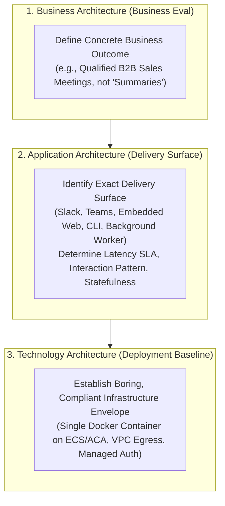
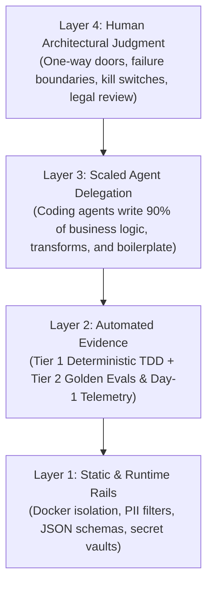

# Chapter 1: The Shift — From Deterministic SDLC to Probabilistic Execution

> "Emergent architecture does not mean 'no architecture up front.' It means you design the enterprise constraints up front and defer internal code decomposition until empirical evidence is gathered."

---

## 1. The Core Paradox: Velocity vs. Reliability

Modern coding agents can synthesize thousands of lines of syntactically valid application code in seconds. They generate database migrations, route handlers, UI components, and API integrations with unprecedented velocity. 

Yet, this velocity introduces a dangerous structural illusion: **the 90% trap**. 

A developer prompts an agent, receives a complete working interface with mock data or an open-ended LLM call, and observes a working demonstration. The system appears finished. In reality, it has cleared zero production criteria:
- It possesses no failure boundaries for malformed model outputs.
- It lacks deterministic citation and groundedness guarantees.
- It exposes unbounded cost and latency attack surfaces.
- It cannot be regression-tested deterministically.

The industry has labeled casual prompt exploration **"vibe coding."** Vibe coding treats software construction as an unconstrained dialogue with a stochastic model, evaluating success through anecdotal manual spot-checks ("I ran three prompts and they looked good").

**AI-Native Engineering** is the structural antidote. It establishes that as the cost of code synthesis trends toward zero, the value of **architectural judgment, automated evidence, and fail-closed system boundaries** trends toward infinity.

```
       ▲  [HUMAN ARCHITECTURAL JUDGMENT]   ◄── One-way doors, failure boundaries, blast radius
      / \
     /   \ [SCALED DELEGATION]             ◄── Coding agents generate 90% of boilerplate & logic
    /     \
   /       \ [AUTOMATED EVIDENCE]          ◄── Tier 1 Deterministic TDD & Tier 2 Golden Evals
  /─────────\
 /           \ [STATIC & RUNTIME RAILS]     ◄── Container boundaries, schemas, typed contracts
 ═════════════
```

---

## 2. Why Classic Deterministic SDLC Collapses

For four decades, the Software Development Life Cycle (SDLC) operated on an invariant mathematical assumption: **software execution is deterministic**.

$$\text{Classic SDLC:} \quad f(x) = y \quad (\forall x \in \text{Domain})$$

In traditional computing:
1. **Inputs map to discrete outputs:** Given input $x$ and fixed internal state $S$, the function $f(x, S)$ returns output $y$ identically across one million invocations.
2. **Defects are binary:** A bug is an unhandled branch, an incorrect arithmetic operation, or an out-of-bounds index. Unit tests assert strict equivalence: `assert result == expected`.
3. **Compilers and type systems guard the runtime:** Rust, TypeScript, or Go verify memory safety and contract compliance before execution begins.
4. **Failure is exceptional:** When an error occurs, the system throws an exception, logs a stack trace, and aborts or restarts cleanly.

### The Probabilistic Reality of LLMs

Large Language Models do not compute functions; they sample distributions over an unbounded vocabulary space:

$$\text{Probabilistic Execution:} \quad P(y \mid x, \theta)$$

| Dimension | Deterministic Software (Classic SDLC) | Probabilistic AI System |
| :--- | :--- | :--- |
| **Output Space** | Bounded, typed, and enumerable ($y \in Y$) | Unbounded, generative token sequences ($y \sim P(Y \mid x)$) |
| **Regression Testing** | Exact string or object equality (`assert a == b`) | Distributional assertions, semantic distance, judge evals |
| **Failure Modes** | Loud crashes (HTTP 500, unhandled exceptions) | **Silent failures** (HTTP 200, plausible hallucination, hollow data) |
| **Performance SLA** | Millisecond-level variance governed by CPU/IO | Second-level variance governed by token output length and queuing |
| **Refactoring Risk** | Compiler catches contract mismatches | Prompts degrade silently across subtle context alterations |

When organizations attempt to force LLMs into classic waterfall or pure deterministic agile cycles without adaptation, two pathologies emerge:
1. **The "Freeze Too Early" Trap:** Architects write 50-page technical specifications and microservice schemas before testing whether the foundation model can extract the required signals from unstructured real-world context.
2. **The "Vibe Deploy" Trap:** Teams deploy open-ended agent loops directly to users, only to suffer brand damage when an agent hallucinates commitments, drops citations, or enters infinite execution loops.

---

## 3. The Architecture-First Mindset: BDAT Adapted for AI

To avoid both traps, AI-native engineering adopts an **architecture-first mindset**. We borrow the enterprise rigor of TOGAF’s **BDAT** (Business, Data, Application, Technology) framework, but strip its waterfall bureaucracy in favor of rapid, eval-driven execution.

Before writing a single line of application code or agent scaffolding, lock down three structural layers:



### 1. Business Architecture $\rightarrow$ The Business Eval
What real-world economic outcome does this system produce? 
- If you are building an automated B2B sales intelligence agent, your business outcome is **qualified prospect meetings booked** or **pipeline created**. It is *not* "number of web pages summarized" or "tokens generated."
- If you are building a legal document extraction tool, the business outcome is **paralegal review time reduced with zero missed indemnification clauses**.

> [!IMPORTANT]
> A technical metric (e.g., ROUGE score, perplexity, cosine similarity) is only valid if it demonstrably correlates with the business outcome. If your retrieval recall jumps from 0.50 to 0.95 but user conversion remains flat, you are optimizing the wrong fitness function.

### 2. Application Architecture $\rightarrow$ Delivery Surface Constraints
Where does the user actually do their work?
- **Adoption fails when you force users into a disconnected surface.** If enterprise sales reps live in Slack or Microsoft Teams, forcing them to open a custom React dashboard guarantees abandonment.
- The delivery surface dictates the **technical boundary conditions**:
  - **Synchronous vs. Asynchronous:** A Slack bot can respond with an initial acknowledgement and stream updates over 30 seconds. A search autocomplete dropdown must respond in $\le 200\text{ ms}$.
  - **Human-in-the-Loop Placement:** Where does the human review, edit, or approve external side-effects?
  - **Auth and Identity:** How is enterprise RBAC (Role-Based Access Control) propagated down to retrieval contexts?

### 3. Technology Architecture $\rightarrow$ Boring Deployment Envelope
Do not invent novel distributed systems or orchestrators to test an AI hypothesis.
- Select the simplest compliant runtime: a **single Docker container** deployed to an existing enterprise compute environment (e.g., Azure Container Apps, AWS ECS, Google Cloud Run).
- Wire secrets management (AWS Secrets Manager, Azure Key Vault), managed identity, and VPC egress rules on day one.
- **Rule of Thumb:** If your prototype cannot run securely within the enterprise compliance envelope on day two, it is a toy that will stall in Architecture Review for six months.

---

## 4. One-Way Doors vs. Agent-Delegated Decisions

Amazon’s famous distinction between **Type 1 decisions (One-Way Doors)** and **Type 2 decisions (Two-Way Doors)** is the central governing heuristic of AI-native engineering.

- **Two-Way Doors (Reversible):** Can be walked through and walked back. If an agent generates messy internal helper functions, suboptimal variable names, or unpolished CSS, the cost of rewriting or regenerating that code is near zero.
- **One-Way Doors (Irreversible):** Decisions that are extraordinarily costly, dangerous, or slow to reverse once committed to production.

Coding agents must be unleashed on two-way doors and strictly constrained by human architects on one-way doors:

| Architectural Decision | Category | Who Decides | Why It Matters |
| :--- | :--- | :--- | :--- |
| **Business Outcome & Fitness Metric** | One-Way Door | **Human Architect** | Iterating against the wrong objective produces technically functional waste. |
| **Delivery Surface & Deployment Baseline** | One-Way Door | **Human Architect** | Dictates enterprise security, compliance boundaries, and user adoption. |
| **Pipeline vs. Autonomous Agent Loop** | One-Way Door | **Human Architect** | Determines system testability, operational observability, and hard cost ceilings. |
| **Trust vs. Verification Boundaries** | One-Way Door | **Human Architect** | Defines the blast radius of model hallucinations and security exploits. |
| **State Persistence & Idempotency** | One-Way Door | **Human Architect** | Rerunning failed distributed steps without state locks corrupts downstream systems. |
| **Human-in-the-Loop Sign-off Gates** | One-Way Door | **Human Architect** | Controls legal liability, brand reputation, and unauthorized external mutations. |
| **Stage Input/Output Contracts** | One-Way Door | **Human Architect** | Upstream and downstream services build dependencies against these interfaces. |
| **Internal Module Layout & Glue Code** | Two-Way Door | **Coding Agent** (Review) | Trivially refactored, split, or regenerated as requirements shift. |
| **Prompt Phrasing & Formatting** | Two-Way Door | **Coding Agent** / Iteration | Empirical prompt tuning is cheap and easily evaluated against golden sets. |
| **Boilerplate & Client SDK Wrappers** | Two-Way Door | **Coding Agent** | Standard repetitive code where agents excel with minimal architectural risk. |

> [!CAUTION]
> Never allow a coding agent to choose where state lives, how failures recover, or whether human approval is required before external actions. These are one-way doors that define the system's reliability profile.

---

## 5. The Four-Layer Safeguard Hierarchy

To structure your build, AI-Native Engineering builds upon the inverted pyramid originally articulated by Lauren Tan (`@poteto`), expanding it into four concrete engineering layers:



1. **Layer 1: Static & Runtime Rails:** Strict schema validation, Docker container isolation, VPC networking, enterprise secret managers, and deterministic token/step bounds.
2. **Layer 2: Automated Evidence:** Fast regression test suites consisting of Tier 1 deterministic TDD assertions and Tier 2 proxy judgment evals run against curated golden datasets.
3. **Layer 3: Scaled Agent Delegation:** Coding agents tasked with implementing algorithms, parsing data, structuring API clients, and iterating rapidly within the safe sandbox established by Layers 1 and 2.
4. **Layer 4: Human Architectural Judgment:** Senior engineering judgment governing one-way doors, trade-offs between flexibility and predictability, and final sign-off on production architecture.

By establishing this hierarchy, engineering teams maintain the breathtaking velocity of modern generative AI without forfeiting the architectural rigor required by enterprise production systems.
