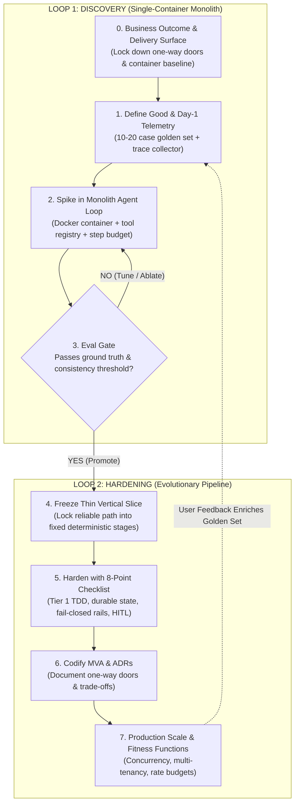
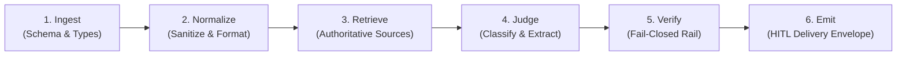

# Chapter 2: The Two-Loop Lifecycle — Discovery Spikes to Hardened Slices

> "Using an open agent loop with tools is ideal for Loop 1 (Discovery) because it lets you test what signals and tools actually work. Once you see what works, freeze the reliable path into fixed stages in Loop 2 to maximize consistency, testability, and cost control."

---

## 1. The Engineering Dilemma: Freedom vs. Control

When building AI applications, engineering teams routinely oscillate between two catastrophic extremes:

1. **Premature Hardening (The Waterfall Trap):** The team attempts to design a complete, multi-service, event-driven architecture before testing whether the underlying LLM can reliably perform the core cognitive task. They spend weeks configuring queues, databases, and microservice boundaries, only to discover that the model cannot extract the required data or that the prompt strategy is fundamentally flawed.
2. **Permanent Prototyping (The Vibe Trap):** The team writes an open-ended autonomous agent loop equipped with ten tools and deploys it directly to staging or production. The agent occasionally succeeds, but suffers from non-deterministic branching, looping tool executions, cascading latency, unpredictable token bills, and zero unit testability.

To resolve this dilemma, AI-Native Engineering partitions development into two distinct, sequential loops separated by a quantitative **Eval Gate**:



---

## 2. Loop 1: The Discovery Spike

The objective of Loop 1 is **empirical signal discovery**: determining what context, retrieval strategies, tools, and prompts actually produce high-judgment output that delights users.

### The Monolithic Container Pattern
In Loop 1, **never build microservices**. Build a single Docker container monolith. 
- **Collocation:** Keep the agent runner, tool registry, prompt templates, and evaluation harness inside a single code repository and container environment.
- **Fast Iteration:** Refactoring an in-process Python function takes seconds; coordinating updates across three microservices takes days.
- **Real User Exposure:** Package the monolith with a minimal delivery surface (e.g., a lightweight Slack bot, CLI tool, or internal web UI) and put it into the hands of a small group of friendly internal users immediately. A prototype is only real when an end user can touch it.

### The Open Agent Loop with Tools
During discovery, you do not know the exact sequence of steps required to solve every case. An open agent loop with tools (search APIs, headless scrapers, vector stores, calculators) allows the model to explore:
- Does the model need domain documentation before or after reading the user query?
- Does web search produce higher precision than internal vector retrieval?
- Does a secondary formatting prompt improve extraction quality?

```python
# Conceptual Loop 1 Open Agent Loop with Step Budget
class DiscoveryAgent:
    def __init__(self, tools: ToolRegistry, max_steps: int = 5):
        self.tools = tools
        self.max_steps = max_steps  # Hard bound on exploratory recursion

    def execute(self, goal: str) -> RunTrace:
        trace = RunTrace(goal=goal)
        for step in range(self.max_steps):
            action, args = self.model.decide_next_step(goal, trace.history)
            if action == "FINAL_ANSWER":
                trace.mark_complete(args)
                return trace
            result = self.tools.execute(action, **args)
            trace.record(step, action, args, result)
        trace.mark_budget_exceeded()
        return trace
```

> [!TIP]
> Always enforce a strict **step budget** (e.g., $\le 5$ iterations) on discovery agents. Without a hard step ceiling, an unconstrained model will cycle indefinitely through failing tool calls, generating runaway latency and token costs.

---

## 3. The Eval Gate

How do you know when a discovery spike is ready to graduate to production architecture? You do not guess, and you do not rely on a developer's intuition. You run the spike against an **Eval Gate**:

1. **Deterministic Schema Gate:** Does the output conform 100% of the time to the required JSON schema, containing all necessary fields without malformed structures?
2. **Citation & Groundedness Gate:** Is every factual claim explicitly backed by an authoritative source URL or retrieved chunk ID?
3. **Accuracy Threshold:** Does the system achieve $\ge 85\text{--}90\%$ agreement against the 10–20 curated golden cases?
4. **Step-Budget Stability:** Does the agent solve standard cases within a predictable step envelope without cyclic tool thrashing?

If the spike fails any of these criteria, it remains in Loop 1. You ablate prompts, adjust tool definitions, refine retrieval chunks, and re-test.

---

## 4. Loop 2: Hardening & Evolutionary Architecture

Once the Eval Gate passes, the discovery phase is over. **You do not ship the open agent loop to production.** 

Instead, you analyze the telemetry traces generated during Loop 1, identify the reliable path, and **freeze that flow into a deterministic multi-stage pipeline**.

### Freezing the Reliable Path
An open agent loop is powerful for discovery, but dangerous in production:
- **Non-deterministic branching:** On identical inputs, an agent might invoke 2 tools on Monday and 8 tools on Tuesday.
- **Untestable state space:** Testing all possible permutations of an autonomous agent loop is combinatorial and mathematically intractable.
- **Operational overhead:** Debugging why a customer request failed requires inspecting an open-ended dialogue tree rather than an isolated function call.

In Loop 2, you convert the winning path into a fixed sequence of stages:



Each stage becomes an isolated, testable engineering unit:
- **Stage 1 (Ingest):** Validates input syntax and data contracts before any LLM is called.
- **Stage 2 (Normalize):** Standardizes entity names, domains, and inputs deterministically.
- **Stage 3 (Retrieve):** Fetches verified context from caching layers or databases with bounded timeouts.
- **Stage 4 (Judge):** Executes bounded semantic reasoning using a tightly constrained prompt and temperature setting.
- **Stage 5 (Verify):** A deterministic code rail that verifies citations against the retrieved context. If citations are missing or unverifiable, it **fails closed** (drops or flags the claim).
- **Stage 6 (Emit):** Packages the final payload into the delivery envelope and flags external actions for human sign-off.

---

## 5. The 8-Point Production Ship Checklist

A thin vertical slice is only "production-ready" when it satisfies all eight criteria of the production ship checklist. If a criterion is not met, mark it **"Next"**, not **"Done"**:

| # | Criterion | What "Vibe Done" Looks Like | What "Production Done" Looks Like |
| :---: | :--- | :--- | :--- |
| **1** | **Deterministic TDD & Evals Pass** | "I tested 3 prompts and they looked good." | Unit/functional tests pass in CI; golden set clears the quantitative eval gate. |
| **2** | **Failure Modes Named & Handled** | A generic `try/except: pass` that returns empty strings. | Timeouts, rate limits, malformed JSON, and empty retrieval have defined policies (retry, skip, fail closed). |
| **3** | **Durable State & Idempotency** | Rerunning a failed job resends emails or duplicates rows. | Stages persist checkpoints to durable storage; executions resume at the point of failure. |
| **4** | **Day-1 Observability Wired** | Local `print()` statements scattered in terminal logs. | Every run emits structured telemetry classifying outcomes: `CLEAN`, `DEGRADED`, `HOLLOW`, `FAILED`. |
| **5** | **Cost & Latency Budgets Enforced** | Assuming model costs are "cheap enough" without logging. | Actual p95 latency and token dollar costs measured per run and bounded by hard ceilings. |
| **6** | **Human-in-the-Loop Sign-Off** | The agent writes directly to production DBs or emails users. | Explicit human approval gate before any external mutation or message dispatch. |
| **7** | **Data Boundaries & Secret Hygiene** | API keys committed in `.env`; raw customer PII sent in prompts. | Cloud secret manager integration; automated PII scrubbing prior to model ingestion. |
| **8** | **Decisions Documented (MVA + ADRs)** | "The architecture is in my head." | Half-page Architecture Decision Records documenting one-way doors, rejected alternatives, and fitness functions. |

---

## 6. The Minimum Viable Architecture (MVA) and ADRs

An enterprise Architecture Review Board (ARB) does not want a 50-page theoretical document describing a hypothetical future system. They want an **MVA (Minimum Viable Architecture)**:
1. **The Thin Vertical Slice:** One real path working end-to-end through every layer (ingest, retrieval, model, verification, delivery).
2. **The Eval Numbers:** Empirical pass rates across golden test cases showing groundedness and accuracy.
3. **Architecture Decision Records (ADRs):** Lightweight, half-page records documenting the irreversible one-way doors chosen during Loop 2.

### What Goes into an AI-Native ADR?
Every critical one-way door must be documented using the standardized ADR format (see [templates/adr-template.md](../templates/adr-template.md)):
- **Context & Business Eval:** What business outcome triggered the decision?
- **Delivery Surface Constraints:** Why does the chosen app layer constrain this decision?
- **Loop 1 vs. Loop 2 Choice:** Why is this component a fixed pipeline stage rather than an open agent loop?
- **One-Way Door Reversibility & Blast Radius:** What breaks if this decision is wrong?
- **Tier 1 & 2 Eval Gates:** What quantitative evidence proved this option superior to alternatives?
- **Next Fitness Functions:** What automated tests will be added before scaling traffic (e.g., concurrency ceilings, cross-region failover)?

By following this two-loop progression, engineering teams eliminate guesswork, protect their organizations from silent failures, and build systems that scale gracefully from prototype to enterprise reality.
