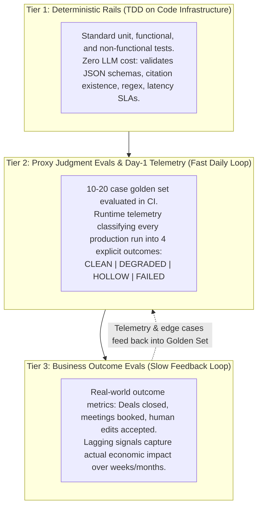
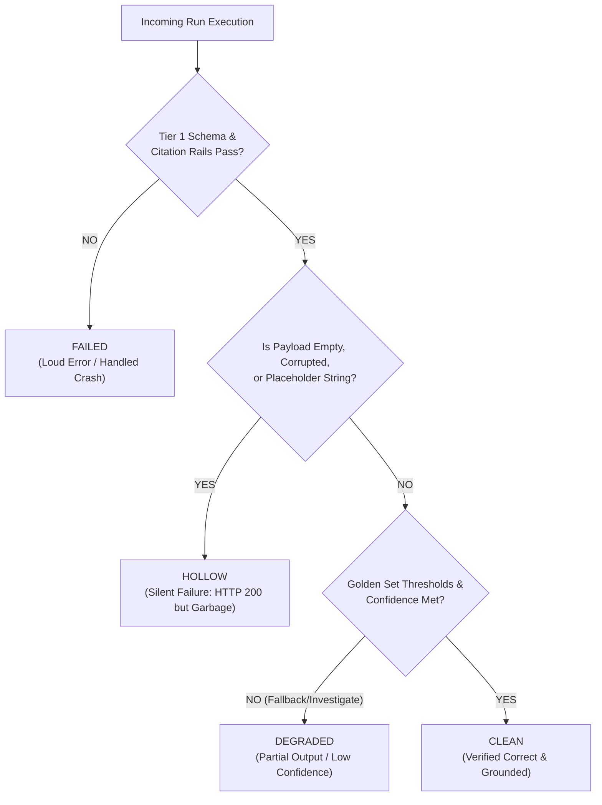
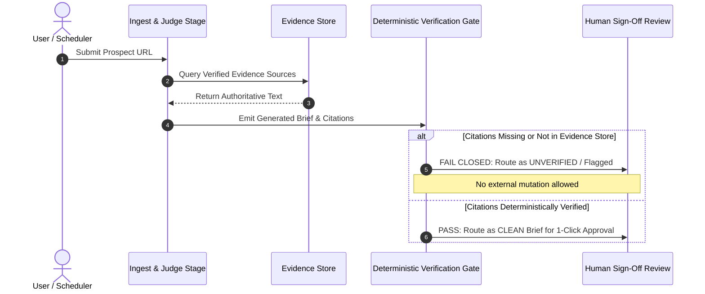

# Chapter 3: Evals & Telemetry — The Three-Tier Testing Stack

> "AI engineering does not replace Test-Driven Development (TDD); it adds an evaluation layer on top of it. Deterministic code rails must always run before semantic judges. And in production, liveness is never correctness."

---

## 1. The Testing Hierarchy for Probabilistic Systems

In classical software engineering, testing validates that code executes as written. In AI engineering, testing must additionally validate that **model judgment aligns with human domain truth** and that **silent failures are detected instantly**.

To achieve this, AI-Native Engineering organizes verification into a **Three-Tier Testing Stack**:



---

## 2. Tier 1: Deterministic Rails (TDD on Infrastructure)

Deterministic rails are standard unit, functional, and contract tests that execute in milliseconds in local development environments and CI pipelines. **They require zero LLM API calls and cost zero dollars.**

Every AI pipeline is surrounded by deterministic code:
- Request parsers and input normalizers
- JSON schema validators
- Citation format checkers
- Database connectors and transaction checkpoints
- Auth and rate-limiting middleware

### The Invariant: Code Checks Run Before Model Calls
Never invoke an LLM judge or expensive downstream model if the input or generated payload fails pure code validation. 

```python
# Tier 1 Example: Deterministic Validation Before Model Invocation
def validate_tier1_contract(payload: dict) -> list[str]:
    issues = []
    required_keys = {"case_id", "decision", "summary", "citations", "confidence"}
    
    missing = required_keys - set(payload.keys())
    if missing:
        issues.append(f"Missing required fields: {sorted(list(missing))}")
        
    if payload.get("decision") not in {"QUALIFY", "INVESTIGATE", "DISQUALIFY", "REJECT"}:
        issues.append(f"Invalid decision enum: {payload.get('decision')}")
        
    citations = payload.get("citations", [])
    if not isinstance(citations, list) or len(citations) == 0:
        issues.append("Deterministic violation: non-empty citations list required")
    elif not all(c.startswith(("http://", "https://")) for c in citations if isinstance(c, str)):
        issues.append("Deterministic violation: citations must be valid HTTP(S) URLs")
        
    return issues
```

If Tier 1 validation fails, the run is immediately aborted and classified as `FAILED`. No downstream tokens are consumed.

---

## 3. Tier 2: Proxy Judgment Evals & Day-1 Telemetry

Tier 1 validates syntax; Tier 2 validates **semantic judgment, groundedness, and factual consistency**.

### The 10–20 Case Golden Set
Do not attempt to assemble a 1,000-case dataset before shipping your initial slice. You do not have the time, and large synthetic datasets dilute focus.

Assemble a **curated golden set of 10 to 20 realistic cases per domain/sector**:
- **70% Representative Cases:** Standard, typical prospect profiles or documents that reflect daily operational traffic.
- **30% Hostile Edge Cases:** The nasty real-world exceptions:
  - Companies with ambiguous, dual-brand corporate structures.
  - Documents with missing financial disclosure dates.
  - Queries designed to induce prompt injection or citation hallucination.
  - Paywalled or empty retrieval responses.

Every golden case includes:
1. Exact input context or source document references.
2. The expected semantic decision (e.g., `QUALIFY` vs. `REJECT`).
3. Acceptable citation URLs that must substantiate the decision.
4. Hard boundary conditions (minimum acceptable confidence score).

### The Cross-Provider Judge Rule
When employing an LLM-as-a-judge for semantic verification:
> [!IMPORTANT]
> **Never evaluate a model's output using the same model family that generated it.** 
> Models developed by the same provider share training data distributions, tokenizers, and systemic blind spots. An error made by `gpt-4o` will frequently appear valid to `gpt-4o-mini`. Always use a cross-provider judge (e.g., evaluate Anthropic Claude generations with OpenAI models, or vice versa) or calibrate your judge against rigorous human labels.

### Day-1 Telemetry: The 4-State Production Taxonomy
Traditional APMs (Application Performance Monitors) track uptime, response codes, and CPU load. For AI applications, **HTTP 200 is meaningless**. A service can return status code 200 while outputting a completely fabricated answer or an empty string.

AI-Native Engineering mandates that **every single execution emit structured telemetry classifying the run into one of four explicit states**:



| Classification State | Technical Definition | Runtime Symptom & Manifestation | Alerting Policy | Operational Remediation |
| :--- | :--- | :--- | :--- | :--- |
| **`CLEAN`** | Flawless technical and semantic execution. | Output matches schema, all claims cited against store, confidence above threshold ($\ge 0.85$). | Normal logging; no alerts. | Baseline telemetry recorded for latency and token tracking. |
| **`DEGRADED`** | System executed successfully but with partial evidence or fallback logic. | Web search timed out so cached data was used; confidence fell below target ($0.60 \le c < 0.85$); flagged as `INVESTIGATE`. | Low-priority digest alert if degraded rate exceeds 20% over 1 hour. | Review retrieval query embeddings or upstream data provider latency. |
| **`HOLLOW`** | **Silent failure.** The process returned exit code `0` or HTTP `200`, but produced empty, placeholder, or ungrounded payload. | Summary contains `"N/A"`, `"TBD"`, or generic hallucination; citation URLs do not exist in evidence store; zero tokens emitted. | **P1 / High-Severity Alert.** Immediate Slack/PagerDuty notification. | Freeze pipeline; inspect prompt drift or upstream payload corruption. |
| **`FAILED`** | Loud technical crash safely intercepted. | Schema validation failure; unhandled JSON parsing exception; upstream API hard 500 error. | Standard error logging; alert if rate exceeds 5% threshold. | Inspect external API credentials, networking, or unhandled input types. |

### Why `HOLLOW` is the Deadliest Production Failure
In enterprise environments, a `FAILED` run is noisy but safe: the pipeline halts, nothing is sent to a client, and an engineer investigates. 

A `HOLLOW` run is catastrophic. The supervisor sees green status indicators, the database logs a completed row, and a sales rep sends an automated brief reading:
> *"Prospect Company: None found. Recent news: As an AI language model, I do not have real-time access to the internet."*

By treating `HOLLOW` as a first-class state with immediate telemetry alarms, AI-Native systems prevent silent failure propagation.

---

## 4. Tier 3: Business Outcome Evals (Slow Feedback Loop)

Ultimately, systems are evaluated on their real-world economic impact. 

| Business Domain | Proxy Metric (Tier 2) | True Business Eval (Tier 3) | Feedback Lag |
| :--- | :--- | :--- | :--- |
| **B2B Sales Intelligence** | Grounded prospect extraction accuracy | Qualified meetings booked; deals won | 30 to 90 days |
| **Customer Support Agent** | Hallucination rate; intent match score | CSAT score; human escalation rate | 1 to 7 days |
| **Code Migration Assistant** | Syntax correctness; unit test pass rate | PR merge rate; engineer review time | 2 to 5 days |

Because Tier 3 signals take days or months to materialize, **you cannot gate continuous deployment on them**. 

### Closing the Feedback Bridge
Instead, build a feedback bridge between Tier 3 and Tier 2:
1. Capture explicit human actions on the delivery surface:
   - Did the sales rep send the draft or edit 80% of it?
   - Did the user click "Thumbs Down" or report an inaccurate citation?
2. Tag those interactions with the unique `run_id` from the Tier 2 telemetry trace.
3. Every week, extract runs where human feedback contradicted Tier 2 scores. **Convert those production failures into new test cases in your Tier 2 Golden Set.**

This feedback mechanism ensures your fast daily eval harness stays calibrated to live business reality.

---

## 5. Fail-Closed Architectural Policies

When building non-deterministic systems, adopt the foundational cybersecurity principle of **failing closed**:

$$\text{When uncertain, do nothing rather than doing something wrong.}$$

In customer-facing workflows, the damage of a false positive (sending a fabricated financial claim to an enterprise prospect) is an order of magnitude worse than a false negative (failing to send a brief and flagging the account for human review).



By enforcing fail-closed deterministic verification gates between stages, your AI system remains grounded, auditable, and production-safe.
