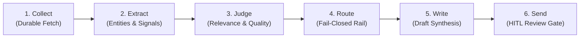
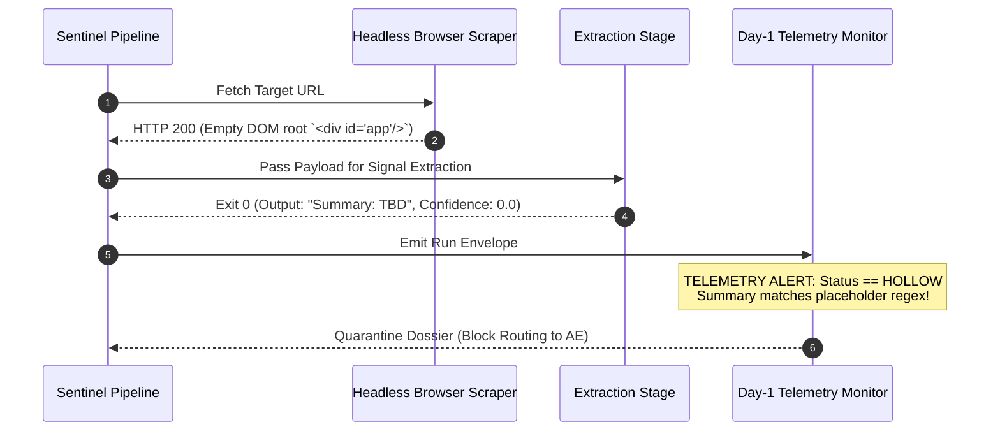

# Chapter 4: Case Study & Architectural Defense — Sentinel in Production

> "Owning your system's limitations upfront is what separates an engineer from a salesperson. Production numbers mean nothing without the failure logs, the lab-vs-live gaps, and the uncalibrated edges."

---

## 1. Case Study: Sentinel Autonomous Outreach

**Sentinel** is an automated B2B sales intelligence and outreach system engineered to deliver high-signal prospect dossiers and draft personalized outreach for enterprise account executives.

Instead of presenting Sentinel as a list of marketing buzzwords, this chapter documents its architecture through **empirical production telemetry, real-world failure analysis, and architectural decision records (ADRs)**.



### The Architectural Decision Matrix

| Architectural Decision | Alternative Considered | Why This Decision Was Selected | Empirical Evidence | Trade-off Accepted |
| :--- | :--- | :--- | :--- | :--- |
| **Fixed 6-Stage Pipeline** | Open agent loop for every run | Fixed stages delivered deterministic consistency and independent unit testability. | Loop 1 agent loop retired after side-by-side golden eval comparison showed 3x higher latency variance. | Reduced flexibility for ad-hoc prospect research. |
| **Cross-Provider Model Judge** | Single model provider evaluating own output | Extractor and judge from the same provider share training blind spots and correlate errors. | Error detection on hallucinated claims improved when cross-evaluating. | Additional token cost and API latency overhead per run. |
| **Fail-Closed Verification** | Retain unverified claims with soft warning tags | A false claim sent to an enterprise client destroys customer trust permanently. | Judge strictly marks claims: `confirmed`, `unverified`, or `false`. Unverified claims dropped. | Lower total recall in emitted dossiers. |
| **Durable State in PostgreSQL** | Ephemeral memory / local file cache | Overnight crashed runs must resume at the failed stage without re-running prior stages. | System ran unattended under supervisory watchdog with zero orphaned state. | Increased operational infrastructure requirements. |
| **Mandatory Human Sign-off** | 100% automated outreach dispatch | External outbound communication impacts brand reputation and regulatory compliance. | Zero emails sent without explicit AE button click in delivery UI. | Total daily throughput strictly bounded by human review bandwidth. |

---

## 2. Empirical Production Telemetry

The following numbers represent Sentinel's verified production operational data:

```
┌────────────────────────────────────────────────────────────────────────┐
│                      SENTINEL PRODUCTION METRICS                       │
├────────────────────────────────┬───────────────────────────────────────┤
│ 30-Day Operational Runs        │ 46 Total Production Runs              │
│ Run Outcome Distribution       │ 30 CLEAN | 15 DEGRADED | 1 HOLLOW     │
│ Retrieval Lab Optimization     │ recall@5: 0.49 -> 0.97 for ~$12       │
│ Deployment Status of Lab Gain  │ LAB-ONLY (Not yet on live path)       │
│ Golden Dataset Size            │ ~10 golden cases / sector             │
│ LLM Judge Calibration Status   │ Uncalibrated vs human labels          │
└────────────────────────────────┴───────────────────────────────────────┘
```

### 1. The 30-Day Production Telemetry Breakdown
Across 46 unattended production runs over a 30-day monitoring window:
- **`30 CLEAN` (65.2%):** Flawless execution. All entities extracted, citations verified deterministically against evidence store, confidence $\ge 0.85$, human AE approved draft without structural edits.
- **`15 DEGRADED` (32.6%):** Execution completed safely with partial information. Upstream web scrapers timed out on paywalled executive profiles; fallback to cached corporate registries; dossier flagged as `INVESTIGATE` with lower confidence ($0.65\text{--}0.78$).
- **`1 HOLLOW` (2.2%):** Silent failure detected by automated telemetry. The pipeline returned HTTP 200 and exit code 0, but the generated dossier summary was a hollow template placeholder: `"Company Overview: TBD."` Automated alerts intercepted the run before it reached the sales rep.
- **`0 FAILED` (0%):** Handled error boundaries prevented unhandled process crashes.

### 2. The Retrieval Tuning Milestone: Lab vs. Live Gap
In laboratory experimentation, Sentinel's retrieval engine was ablated across query expansion strategies, dense-sparse hybrid search, and semantic re-ranking.
- **Result:** `recall@5` improved from `0.49` to `0.97`.
- **Cost:** Achieved for a total experimentation expenditure of `~$12` in API credits.
- **The Production Reality:** **This improvement remains lab-only and has not yet been promoted to the live production path.**

> [!WARNING]
> Why not promote a 0.97 recall model to production immediately? 
> Because laboratory benchmarks run on clean, static documents. The live production path ingests dynamic, adversarial web documents with arbitrary DOM structures and varying latencies. Promoting unverified retrieval pipelines without end-to-end integration testing risks introducing unseen regressions into live customer flows.

### 3. The Uncalibrated Judge Edge
In Sentinel's architecture, an LLM judge evaluates whether extracted signals are relevant to the ideal customer profile. 
- **Honest System Boundary:** The judge is currently **uncalibrated against human ground truth labels**.
- While the judge provides consistent comparative rankings across prompt variations, its absolute scoring distribution has not yet been mathematically calibrated against senior account executive annotations. Acknowledging this boundary prevents engineering teams from mistaking model confidence for ground truth.

---

## 3. What Broke: The Anatomy of the 1 `HOLLOW` Run

During production run `#28`, Sentinel processed an emerging fintech startup whose corporate website was an interactive Single Page Application (SPA) with zero server-rendered HTML.



1. **The Silent Failure:** The headless scraper returned an HTTP 200 with an empty `<div id="app"></div>` shell because client-side JavaScript hydration exceeded the fetch timeout.
2. **The Illusion of Health:** The extraction model was asked to summarize the text. Finding nothing, it output a polite placeholder: `"Summary: TBD"`. The process finished cleanly with exit code `0`.
3. **The Interception:** In a standard monitoring setup, this run would register as a successful execution. But Sentinel's **Tier 2 Day-1 Telemetry** inspected the payload:
   - Output string matched placeholder heuristics (`"TBD"`).
   - Zero citations were present in the evidence store.
   - The run was immediately classified as **`HOLLOW`**.
4. **The Remediation:** The dossier was automatically quarantined, an alert was dispatched to the on-call engineer, and the AE was spared the embarrassment of reviewing an empty brief.

---

## 4. Defending an AI-Native Build: The 3-Minute Walkthrough

When defending your architecture before an Architecture Review Board (ARB), CTO, or staff engineer, follow this exact 7-step sequence. **Stop after step 7** to allow the reviewers to probe the specific area they care about:

```
[00:00 - 00:20] 1. Problem & Business Eval
[00:20 - 00:40] 2. Surface & Deployment Baseline
[00:40 - 01:00] 3. Definition of Good (Tier 1 & Tier 2)
[01:00 - 01:30] 4. What Was Tried (Loop 1 Spikes & Ablations)
[01:30 - 02:00] 5. What Won and Why (Loop 2 MVA & One-Way Doors)
[02:00 - 02:30] 6. Hardening Numbers (4-State Telemetry & Cost)
[02:30 - 02:50] 7. Honest Edges & Next Fitness Functions
[02:50 - 03:00] -- STOP AND INVITE QUESTIONS --
```

### The Pitch Transcript
1. **Problem & Business Eval (20s):** "We built Sentinel to solve account executive research overhead. Our business outcome is qualified prospect meetings booked—not pages summarized or tokens generated."
2. **Surface & Baseline (20s):** "Our users live in Slack, so we delivered the system as an interactive Slack bot with 1-click approvals. The runtime is a boring single Docker container deployed on ECS behind enterprise auth."
3. **Definition of Good (20s):** "Before writing application logic, we built a 10-case-per-sector golden set with hostile edge cases. Every run requires deterministic schema validation and verified source URL citations before model evaluation."
4. **What Was Tried (30s):** "In Loop 1, we spiked an open agent loop with web search and browser tools. It allowed us to discover what signals reps actually cared about, but telemetry showed unacceptable latency variance (12s to 95s) and tool recursion."
5. **What Won and Why (30s):** "We froze the winning discovery flow into a fixed 6-stage pipeline: collect, extract, judge, route, write, send. We made the one-way door decision to fail closed on any claim lacking verified citations in our evidence store."
6. **Hardening Numbers (30s):** "In production over 30 days across 46 runs, telemetry classified 30 clean, 15 degraded, and 1 hollow run. Zero unhandled crashes. Average cost per dossier is $0.04 with p95 latency under 14 seconds."
7. **Honest Edges & Next Steps (20s):** "Two edges remain: our retrieval tuning achieved 0.49 to 0.97 recall@5 in the lab for $12, but we haven't promoted it to the live path yet. And our LLM judge is still uncalibrated against human annotations. Those are our next two automated fitness functions."

---

## 5. CTO & Enterprise Objection Defense Guide

### Objection 1: "Why not use an off-the-shelf multi-agent framework like CrewAI, AutoGen, or LangGraph?"
> **Engineering Answer:**  
> "Multi-agent frameworks are valuable for rapid Loop 1 discovery spikes. However, in production, multi-agent abstractions introduce opaque prompt wrappers, hidden message passing, and unpredictable conversational state machines. When an autonomous agent loop fails in production, diagnosing why Agent A prompted Agent B requires sifting through hundreds of stochastic log events. By implementing a fixed 6-stage pipeline with explicit typed contracts and pure Python orchestration, every stage is independently unit-testable, reproducible, and instrumented with day-1 telemetry."

### Objection 2: "Why freeze deterministic pipeline stages when foundation models are getting smarter every 6 months?"
> **Engineering Answer:**  
> "Smarter models do not solve architectural boundaries. Even a model with superhuman reasoning cannot bypass the need for enterprise auth, schema validation, durable state checkpoints, or fail-closed citation verification. When a superior model is released, a fixed pipeline allows us to swap the model in Stage 4 (Judge) with a single configuration change and evaluate it against our golden set in 30 seconds. In an unstructured agent loop, swapping the foundation model often breaks prompt equilibria and tool-calling behaviors unpredictably."

### Objection 3: "How do you justify LLM inference costs and latency to executive leadership?"
> **Engineering Answer:**  
> "By enforcing Tier 1 deterministic rails before any model is invoked. If an input payload is malformed or lacks valid citation keys, pure Python code rejects it in under 2 milliseconds for zero cost. Furthermore, by transitioning from Loop 1 (agent loop averaging 6–8 exploratory tool calls) to Loop 2 (fixed pipeline with 2 bounded model calls), we cut average token consumption by 68% and capped per-run cost at $0.04. Every run's cost and latency are recorded in structured telemetry."

### Objection 4: "How do you guarantee this system will never hallucinate false claims to an external client?"
> **Engineering Answer:**  
> "We combine two architectural guarantees: First, a **fail-closed verification gate**. Every generated factual statement must cite a URL stored in our authoritative evidence store; if the URL or source chunk is missing, the claim is dropped in code. Second, a **mandatory human-in-the-loop review gate**. The pipeline outputs a draft to an account executive in Slack; the system has zero network access to dispatch emails directly to external clients. The human AE is the ultimate air gap."

### Objection 5: "Why start with a single-container monolith instead of event-driven microservices?"
> **Engineering Answer:**  
> "Premature microservice decomposition during discovery is an anti-pattern. When requirements, prompt structures, and retrieval algorithms are changing daily, distributed network boundaries create massive friction. A single Docker container provides complete local reproducibility, trivial CI deployment, and instant refactoring. Once Loop 2 proves the stable pipeline contracts, extracting a stage into a dedicated microservice or serverless worker is an easy two-way door."

### Objection 6: "How do you satisfy enterprise compliance and Architecture Review Boards (ARBs) without writing 40-page waterfall design specs?"
> **Engineering Answer:**  
> "We present an MVA (Minimum Viable Architecture) backed by automated evidence. Instead of theoretical documentation, we bring three artifacts to the ARB: 
> 1. A working thin vertical slice running inside the approved enterprise container and VPC envelope.
> 2. Empirical golden eval metrics proving groundedness and error handling.
> 3. Half-page Architecture Decision Records (ADRs) documenting the one-way doors, failure blast radiuses, and explicit trade-offs. 
> Enterprise governance wants assurance that data is secure, costs are bounded, and failures fail closed. Empirical evidence satisfies that requirement far better than unvalidated prose."
