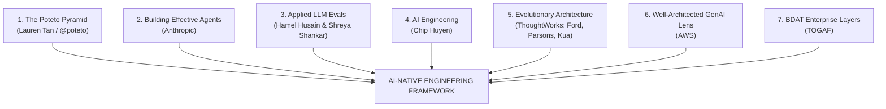

# Chapter 5: Prior Art & Lineage — Grounding in Software & AI Engineering

> "AI-Native Engineering does not invent systems architecture from scratch. It synthesizes decades of foundational systems engineering, evolutionary architecture, and applied evaluation science, adapting them specifically for the stochastic realities of large language models."

---

## 1. Architectural Lineage Overview

Building reliable production software with non-deterministic components requires grounding in battle-tested engineering disciplines. The AI-Native Engineering Framework stands on the shoulders of seven seminal contributions across modern software architecture, applied machine learning, and enterprise systems design:

---

## 2. In-Depth Comparative Analysis

### 1. The Poteto Pyramid (Lauren Tan / `@poteto`)
- **Foundational Concept:** Inverted hierarchy of agentic software development:
  $$\text{Static Safeguards} \longrightarrow \text{Automated Evidence} \longrightarrow \text{Scaled Delegation} \longrightarrow \text{Human Judgment}$$
  As coding agents generate an increasing share of application code, human engineers must retreat to the apex of the pyramid—focusing on architectural trade-offs, security invariants, and one-way doors.
- **Where This Framework Overlaps:** Adopts the 4-layer inverted hierarchy as the governing mental model for agent delegation. The human architect retains exclusive ownership over one-way doors (blast radius, persistence, verification gates), while agents handle scaled boilerplate and implementation logic.
- **Where This Framework Extends It:** 
  - Codifies the concrete **3-Tier Eval Stack** that powers the "Automated Evidence" layer.
  - Operationalizes the **4-state telemetry taxonomy** (`CLEAN`, `DEGRADED`, `HOLLOW`, `FAILED`) to provide continuous runtime verification.
  - Supplies runnable reference implementations and test suites demonstrating deterministic rails in pure Python.

---

### 2. Anthropic: Building Effective Agents (Erik Schluntz & Barry Zhang)
- **Foundational Concept:** The crucial distinction between **Workflows** (orchestrated systems where LLMs and tools navigate predefined code paths) and **Agents** (autonomous systems where LLMs dynamically direct their own processes and tool usage). Anthropic recommends starting with simple workflows and introducing agentic autonomy only when empirical evidence demonstrates necessity.
- **Where This Framework Overlaps:** This framework deliberately inverts the start. Anthropic says start with a workflow; **Loop 1 (Discovery Spike)** starts with an open agent loop, used only as a non-shipping discovery tool. **Loop 2 (Hardening)** then freezes the reliable path into fixed workflow stages, which converges on Anthropic's position for production.
- **Where This Framework Extends It:**
  - Establishes a quantitative **Eval Gate** as the mandatory contractual threshold before graduating an exploratory agent into a fixed pipeline.
  - Introduces the **Fail-Closed Verification Gate**: enforcing deterministic citation checks against an authoritative evidence store before downstream emission.
  - Provides the **8-Point Ship Checklist** governing production readiness.

---

### 3. Applied LLM Evals (Hamel Husain & Shreya Shankar)
- **Foundational Concept:** Pragmatic evaluation methodologies for production LLM applications:
  - Error analysis driven by manual inspection of real failures.
  - Small, high-quality curated **golden sets (10–20 cases)** rather than massive synthetic datasets.
  - Deterministic code assertions executed *before* semantic LLM judges.
  - Identifying and mitigating uncalibrated LLM judges.
- **Where This Framework Overlaps:** Directly incorporates the 10–20 golden case pattern with mandatory representation of hostile edge cases. Strictly enforces Tier 1 deterministic code validation (schema, keys, regex) prior to any model call.
- **Where This Framework Extends It:**
  - Directly couples the golden eval harness to **Day-1 Runtime Telemetry**, using the exact same evaluation logic in CI/CD and production monitoring.
  - Formulates the **Feedback Bridge**: automatically harvesting production runs where human actions contradict model evaluations to grow and recalibrate the golden set.
  - Formalizes the distinction between loud exceptions (`FAILED`) and silent semantic failures (`HOLLOW`).

---

### 4. AI Engineering (Chip Huyen)
- **Foundational Concept:** Evaluation-driven development as the primary engineering paradigm for foundation models; treating runtime telemetry, logs, and user traces as continuous data pipelines for system refinement.
- **Where This Framework Overlaps:** Treats evals as the foundational specification (TDD for probabilistic systems). Mandates that every prompt and pipeline modification be evaluated against automated benchmarks rather than manual ad-hoc testing.
- **Where This Framework Extends It:**
  - Formalizes the silent failure state (**`HOLLOW`**) where an application exits cleanly (HTTP 200) but outputs empty or ungrounded data.
  - Establishes hard architectural constraints: step-budget ceilings on exploratory loops and fail-closed citation policies.
  - Integrates AI engineering practices into standard enterprise software architectures (Docker monoliths, ACA/ECS envelopes).

---

### 5. Evolutionary Architecture (ThoughtWorks: Neal Ford, Rebecca Parsons, Patrick Kua)
- **Foundational Concept:** Building systems designed to support guided, incremental change through **Architectural Fitness Functions**: automated checks that verify architectural characteristics (performance, modularity, security) do not degrade over time.
- **Where This Framework Overlaps:** Replaces static upfront architecture documents with automated fitness functions. Uses Tier 1 and Tier 2 eval gates to continuously protect system integrity as models or prompts change.
- **Where This Framework Extends It:**
  - Formulates **AI-Specific Fitness Functions**:
    - Groundedness pass rate ($\ge 90\%$)
    - Token dollar-cost ceiling per transaction
    - p95 latency envelope
    - Hallucination and unverified citation rate
    - Cross-provider judge divergence threshold
  - Defines how fitness functions govern the evolution from a monolithic discovery spike to a hardened slice.

---

### 6. AWS Well-Architected Framework: Generative AI Lens & P2P
- **Foundational Concept:** Structured guidance for designing, deploying, and operating generative AI workloads on cloud infrastructure. Emphasizes prototype-to-production (P2P) progression, security guardrails, data boundaries, and cost optimization.
- **Where This Framework Overlaps:** Adopts single-container sandbox isolation during discovery, managed cloud secret stores (AWS Secrets Manager / Azure Key Vault), least-privilege IAM roles, and VPC egress control.
- **Where This Framework Extends It:**
  - Replaces heavyweight cloud governance documentation with concise, half-page **Architecture Decision Records (ADRs)** focused on AI one-way doors.
  - Eliminates premature cloud distributed infrastructure during discovery by mandating local and single-container monolith spikes.

---

### 7. TOGAF / BDAT Enterprise Architecture
- **Foundational Concept:** The Open Group Architecture Framework's four-layer enterprise architecture model:
  $$\text{Business} \longrightarrow \text{Data} \longrightarrow \text{Application} \longrightarrow \text{Technology}$$
- **Where This Framework Overlaps:** Enforces that Business Architecture (the Business Eval) and Application Architecture (the Delivery Surface) must be locked down before Technology choices (models, vector databases, frameworks) are considered.
- **Where This Framework Extends It:**
  - Strips TOGAF's months-long waterfall design cycles in favor of rapid, empirical 2-loop iteration.
  - Redefines "Business Architecture" as an automated **Business Outcome Eval** (e.g., qualified meetings booked, claims verified).
  - Redefines "Application Architecture" as the user's primary workflow surface (Slack, Teams, CLI) to guarantee adoption.

---

## 3. Master Synthesis Matrix

| Lineage / Framework | Core Engineering Philosophy | Application in AI-Native Engineering | Specific Framework Extension |
| :--- | :--- | :--- | :--- |
| **The Poteto Pyramid** *(Lauren Tan)* | Inverted hierarchy of software delegation. | Human architect owns one-way doors; agents handle boilerplate code. | Operationalizes Automated Evidence via 3-Tier Evals and 4-state telemetry. |
| **Building Effective Agents** *(Anthropic)* | Workflows (deterministic) vs. Agents (autonomous). | Loop 1 uses agent loops for discovery; Loop 2 freezes reliable workflow paths. | Adds quantitative Eval Gate, fail-closed citation gates, and 8-point ship checklist. |
| **Applied LLM Evals** *(Husain & Shankar)* | Fast iteration via 10–20 golden cases and code-first assertions. | Tier 1 deterministic code rails run before Tier 2 golden evals and LLM judges. | Links golden sets directly to live production telemetry; automates feedback loop. |
| **AI Engineering** *(Chip Huyen)* | Eval-driven design and telemetry as data pipeline. | Full instrumentation of all runs; telemetry traces serve as evaluation inputs. | Formalizes `HOLLOW` silent failure state and enforces strict step budgets. |
| **Evolutionary Architecture** *(ThoughtWorks)* | Architectural fitness functions guarding system properties. | Continuous CI/CD gating against regression, drift, and latency. | Defines AI-specific fitness functions (groundedness, token budgets, cross-provider bias). |
| **AWS GenAI Lens / P2P** *(AWS)* | Cloud security, governance, and prototype-to-production path. | Secure single-container deployment envelope; VPC egress; cloud secret hygiene. | Replaces multi-week design specs with lightweight, empirical ADRs. |
| **TOGAF / BDAT** *(The Open Group)* | Business $\to$ Data $\to$ App $\to$ Tech alignment. | Business outcome and delivery surface locked down before model selection. | Strips waterfall bureaucracy; converts BDAT into iterative, eval-driven execution. |

By synthesizing these seven lineages, the AI-Native Engineering Framework bridges the divide between cutting-edge probabilistic AI and robust, enterprise-grade software architecture.
