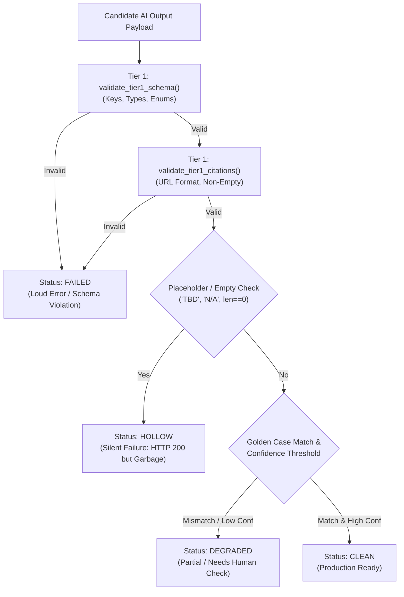

# Example 01: Eval Harness (Tier 1 Rails & Tier 2 Classification)

This example demonstrates the core evaluation pattern of the AI-Native Engineering Framework: **enforcing deterministic code rails before semantic evaluation, and classifying all executions into four explicit operational states.**

---

## 1. Architectural Pattern



The eval harness implements two foundational principles:
1. **Deterministic Rails (Tier 1) Run First:** Pure Python schema and citation checks run in sub-millisecond time with zero LLM API calls and zero dollar cost.
2. **Four-State Telemetry Taxonomy (Tier 2):** Instead of binary pass/fail or relying on HTTP 200, runs are classified into `CLEAN`, `DEGRADED`, `HOLLOW`, or `FAILED`.

---

## 2. What This Example Proves

- **Liveness $\neq$ Correctness:** Demonstrates how silent failures (`HOLLOW`) are caught when an agent returns exit code 0 or HTTP 200 with placeholder text (`"Company Overview: TBD"`) or fabricated citations.
- **Fail-Closed Verification:** Rejects ungrounded claims or missing citations before model evaluation.
- **Golden Set Evaluation:** Compares candidate outputs against `golden_cases.json` containing representative and edge-case domain scenarios.

---

## 3. How to Run

### Run Unit Tests
From this directory:

```bash
python3 -m unittest test_eval_harness.py -v
```

From the repository root:

```bash
PYTHONDONTWRITEBYTECODE=1 python3 -m unittest examples/01-eval-harness/test_eval_harness.py -v
```

### Programmatic Usage

```python
from eval_runner import evaluate_run, Classification

# Example: Evaluating a clean candidate output
candidate_output = {
    "case_id": "case-001",
    "decision": "QUALIFY",
    "summary": "Stripe is expanding enterprise billing infrastructure.",
    "citations": ["https://stripe.com/newsroom/enterprise-billing"],
    "confidence": 0.95
}

golden_case = {
    "id": "case-001",
    "expected_decision": "QUALIFY",
    "min_confidence": 0.80,
    "require_citations": True
}

result = evaluate_run(candidate_output, golden_case)
print(f"Outcome: {result.status} (Score: {result.score})")
# Output: Outcome: CLEAN (Score: 1.0)
```
