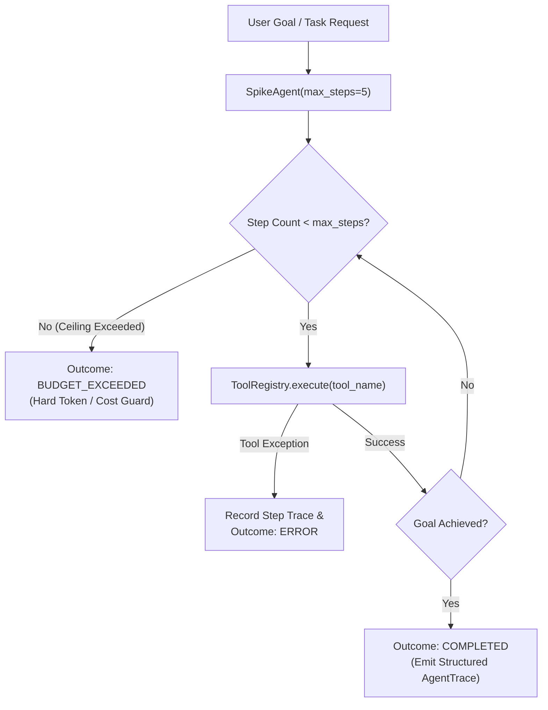

# Example 02: Monolith Spike (Loop 1 Discovery Agent)

This example demonstrates the Loop 1 Discovery pattern of the AI-Native Engineering Framework: **a single-container monolithic spike equipped with an open agent loop, dynamic tool registry, strict step budget, and structured day-1 telemetry.**

---

## 1. Architectural Pattern



In Loop 1 (Discovery), you do not know the invariant execution path. The Monolith Spike pattern enables:
1. **Dynamic Tool Exploration:** Register tools (search, scraping, database queries) in a lightweight in-memory registry.
2. **Hard Step-Budget Ceilings:** Bound exploratory recursion (e.g., maximum 5 iterations) so broken model loops cannot generate infinite token bills or indefinite hangs.
3. **Structured Day-1 Telemetry:** Emits a comprehensive `AgentTrace` containing per-step tool names, arguments, latencies, estimated token counts, and cost.

---

## 2. What This Example Proves

- **Safe Autonomous Exploration:** The agent can dynamically decide which tools to call, while remaining safely enclosed within architectural boundaries.
- **Fail-Safe Budget Guards:** When a task cannot be resolved within the step limit, the agent terminates predictably (`BUDGET_EXCEEDED`) rather than recursing infinitely.
- **Silent Failure Interception:** Executions that exit without taking any steps or emitting outputs are immediately tagged as `HOLLOW`.
- **Trace as Eval Input:** Every execution generates a structured trace that directly feeds into Tier 2 golden evals.

---

## 3. How to Run

### Run Unit Tests
From this directory:

```bash
python3 -m unittest test_monolith_spike.py -v
```

From the repository root:

```bash
PYTHONDONTWRITEBYTECODE=1 python3 -m unittest examples/02-monolith-spike/test_monolith_spike.py -v
```

### Programmatic Usage

```python
from spike_agent import SpikeAgent, ToolRegistry

# 1. Initialize registry and register tools
registry = ToolRegistry()
registry.register("web_search", lambda query: f"Found results for: {query}")
registry.register("extract_signals", lambda content: {"status": "growth", "signal": "expansion"})

# 2. Instantiate agent with a hard step budget
agent = SpikeAgent(registry=registry, max_steps=5)

# 3. Simulate an exploratory execution trace
mock_plan = [
    {"tool": "web_search", "args": {"query": "Acme Corp earnings"}},
    {"tool": "extract_signals", "args": {"content": "Acme Corp expanding into EMEA"}},
]

trace = agent.run(goal="Analyze Acme Corp growth", mock_steps=mock_plan)
print(f"Run ID: {trace.run_id} | Outcome: {trace.outcome} | Steps: {trace.steps_taken}")
# Output: Run ID: run-... | Outcome: COMPLETED | Steps: 2
```
