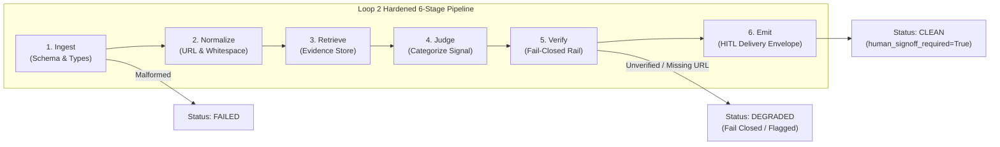

# Example 03: Hardened Slice (Loop 2 Fixed-Stage Pipeline)

This example demonstrates the Loop 2 Hardening pattern of the AI-Native Engineering Framework: **freezing a discovered flow into a fixed 6-stage deterministic pipeline with fail-closed citation verification and mandatory human sign-off.**

---

## 1. Architectural Pattern



Once Loop 1 discovery proves what signals work, Loop 2 replaces the unconstrained agent loop with a fixed sequence of stages:
1. **Stage 1 (Ingest):** Enforces strict dictionary type checks, required field validation (`company_name`, `source_url`), and non-empty string constraints.
2. **Stage 2 (Normalize):** Deterministically standardizes URLs, entity names, and casing.
3. **Stage 3 (Retrieve):** Fetches authoritative text from the verified evidence store.
4. **Stage 4 (Judge):** Executes semantic categorization (`QUALIFY`, `INVESTIGATE`, `REJECT`) based on extracted signals.
5. **Stage 5 (Verify):** Deterministic fail-closed gate. Verifies that all citations exist in the authoritative store. If evidence is missing, the pipeline **fails closed**—flagging the run as `DEGRADED` or unverified rather than guessing.
6. **Stage 6 (Emit):** Packages the final payload into the delivery envelope with `human_signoff_required = True`.

---

## 2. What This Example Proves

- **Deterministic Stage Contracts:** Each of the 6 stages can be tested in complete isolation with deterministic unit assertions.
- **Fail-Closed Architectural Rail:** If an agent hallucinates a URL or references content outside the authoritative evidence store, Stage 5 intercepts the payload and prevents unverified claims from reaching external users.
- **Human-in-the-Loop Enforced:** Outbound messages or mutations cannot occur autonomously; the delivery envelope requires explicit human review.
- **Durable Traceability:** Emits detailed per-stage execution durations and outcome statuses (`CLEAN`, `DEGRADED`, `HOLLOW`, `FAILED`).

---

## 3. How to Run

### Run Unit Tests
From this directory:

```bash
python3 -m unittest test_hardened_slice.py -v
```

From the repository root:

```bash
PYTHONDONTWRITEBYTECODE=1 python3 -m unittest examples/03-hardened-slice/test_hardened_slice.py -v
```

### Programmatic Usage

```python
from pipeline import HardenedPipeline

# 1. Provide an authoritative evidence store
evidence_store = {
    "https://example.com/press/expansion": "Acme Corp announces major expansion into European enterprise markets."
}

# 2. Instantiate pipeline
pipeline = HardenedPipeline(evidence_store=evidence_store)

# 3. Execute with valid input
raw_input = {
    "company_name": "Acme Corp",
    "source_url": "https://example.com/press/expansion",
    "notes": "Fast growing B2B fintech"
}

result = pipeline.run(raw_input)
print(f"Status: {result.status}")
print(f"Human Sign-off Required: {result.human_signoff_required}")
print(f"Decision: {result.final_payload['decision']}")
# Output: Status: CLEAN | Human Sign-off Required: True | Decision: QUALIFY
```
